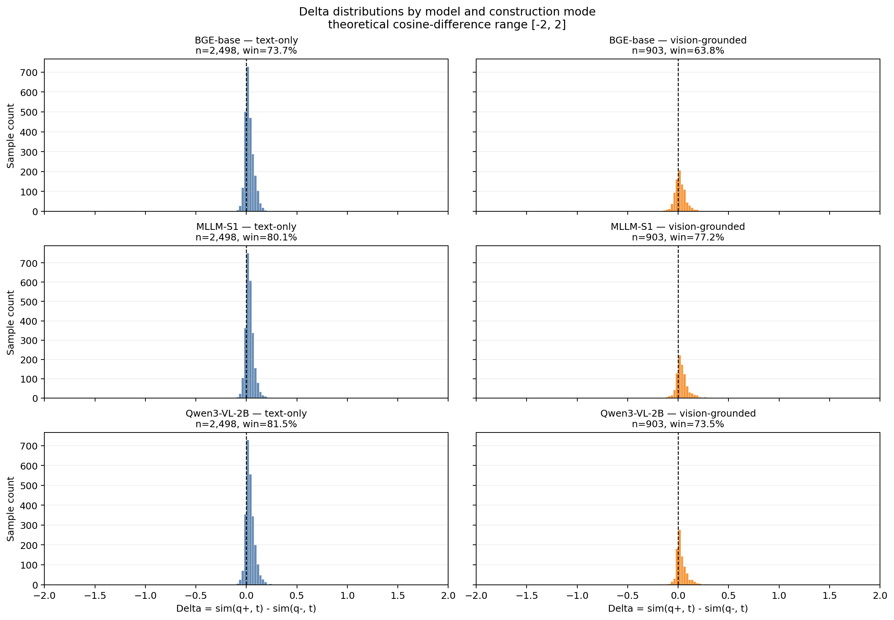
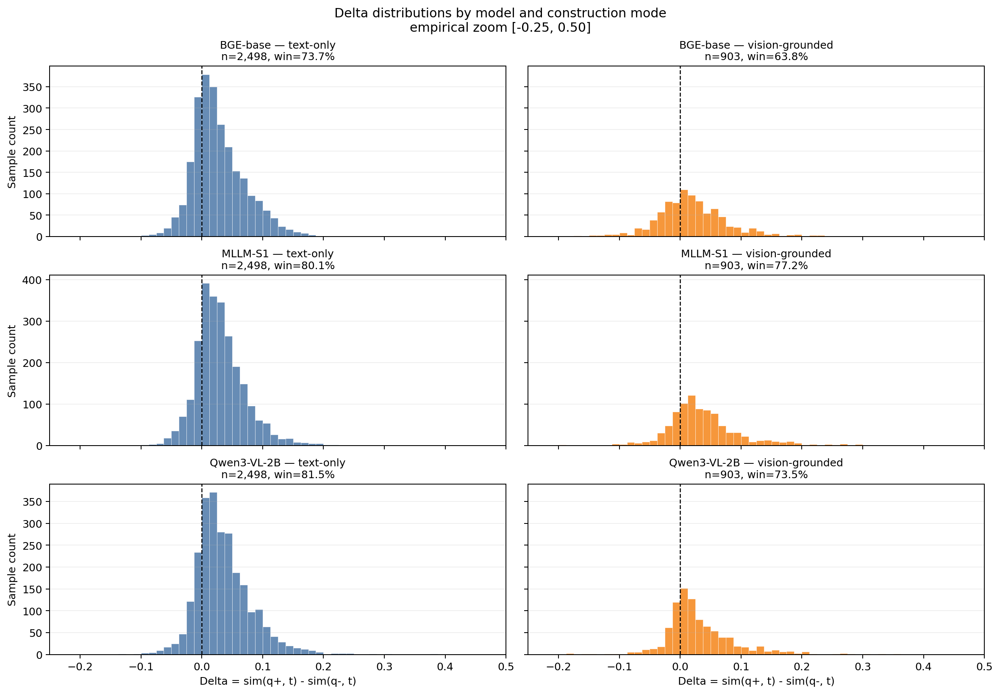
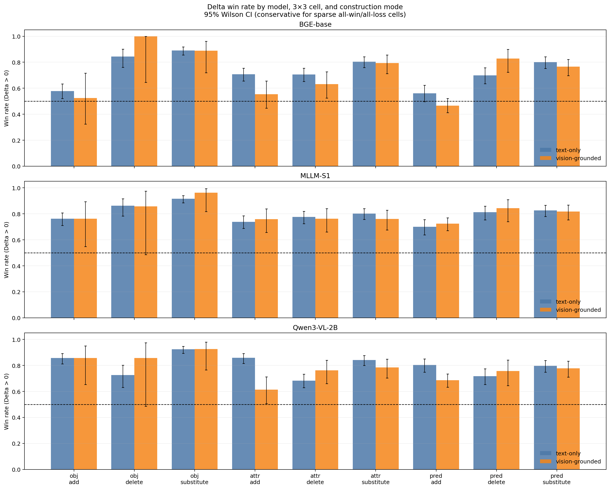

# pilot_500_v5：BGE-VL-base、BGE-VL-MLLM-S1 与 Qwen3-VL-Embedding-2B 全面诊断报告

更新日期：2026-07-21  
分析数据：`pilot_500_v5/final.jsonl` 及三个模型的 `model_diagnostics` 产物  
诊断模型：`BGE-VL-base`、`BGE-VL-MLLM-S1`、`Qwen3-VL-Embedding-2B`（本报告不包含 LinCIR）

## 1. 结论摘要

### 1.1 关于检索判别能力（Delta）

定义：

```text
q+    = f_query(reference, m+)
q-    = f_query(reference, m-)
t     = f_candidate(target)
v     = q+ - q-
Delta = sim(q+, t) - sim(q-, t) = dot(v, t)
```

对 Add 和 Substitute，`Delta > 0` 表示模型把正确修改文本 `m+` 排在错误文本 `m-` 前面。Delete 产生的是更弱查询，不必与 target 冲突，因此其 Delta 只作描述性统计，不纳入主要正确率结论。

最重要的结果是：

- 在严格集合 Add + Substitute（2,622 条）上，Qwen3-VL-Embedding-2B 的 Delta 胜率最高：**81.73%**；MLLM-S1 为 **79.02%**，base 为 **70.52%**。
- Qwen 相对 MLLM-S1 的严格胜率配对提升 **2.71 个百分点**，95% CI `[0.78, 4.63]`；平均 Delta 提升 `+0.0049`，95% CI `[0.0028, 0.0071]`。提升不大，但统计上明确。
- Qwen 的主要优势来自 **text-only Add**：胜率 84.32%，高于 MLLM-S1 的 73.63% 和 base 的 62.23%。在全部 Add 上，Qwen、MLLM-S1、base 分别为 78.91%、73.51%、57.73%。
- **vision-grounded 仍是 MLLM-S1 最强**：严格胜率 76.55%，Qwen 为 72.91%，base 为 61.73%。Qwen 相对 MLLM-S1 在 vision 严格集合下降 3.64pp，95% CI `[-7.20, -0.13]`。
- text/vision 的 raw 差异受到九格组成影响，但控制后结论仍有区分：matched pair×cell 上，base 和 Qwen 的 vision 胜率分别低 7.6pp、10.7pp，CI 均不跨 0；MLLM 低 3.6pp 但 CI 跨 0，同时 vision 的平均 Delta 高 `+0.0136`。因此 MLLM 的 vision 特征是 **更宽、正尾更重**，不是简单地“每条都更容易判对”。
- Substitute 上 Qwen 与 MLLM-S1 基本相同：84.35% 对 84.13%；平均 Delta 差 `+0.0005`，CI 跨 0。Qwen 的总体增益仍主要来自 Add。
- base 的最明显盲点仍是 **predicate × add**：平均 Delta `-0.0007`、胜率 50.64%。Qwen 在该格为平均 Delta `0.0178`、胜率 73.58%；MLLM-S1 为 `0.0148`、71.38%。
- Delete 是描述性集合；Qwen 在该集合反而弱于 MLLM-S1（71.50% 对 80.23%），不能用全部 3,401 条的胜率掩盖这种操作差异。

### 1.2 关于“是否存在 3×3 规律”

答案是：**存在明显、可泛化的统计规律，但还不是一个强而统一的 3×3 向量代数。**

- 从原始差向量 `v` 预测九宫格，OOF 9 分类准确率为：base **55.92%**、MLLM-S1 **55.31%**、Qwen **45.87%**；随机均匀基线 11.11%，多数类基线 16.02%。三者都有可解码信息，但 Qwen 显著更弱。
- 只保留方向 `v / ||v||` 后，准确率上升到 base **62.51%**、MLLM-S1 **62.72%**、Qwen **54.13%**。类别信息都主要编码在方向，而不是长度。
- 单独预测 semantic target 时，MLLM-S1、Qwen、base 分别为 59.63%、57.92%、56.34%；单独预测 edit operation 时分别为 73.27%、65.36%、77.12%。Qwen 的 operation 轴最弱。
- 用“semantic 主效应 + operation 主效应”的固定向量结构解释单条 `v`，交叉验证 R² 只有 base **4.17%**、MLLM-S1 **2.43%**、Qwen **1.48%**；加入完整 9-cell 交互后也只有 **5.22%**、**3.26%**、**2.14%**。
- Qwen 同时表现出“严格 Delta 最好”和“3×3 probe/因子结构最弱”。这是本轮最关键的新证据：**检索判别能力强，不等于编辑向量形成更整齐的 3×3 几何。**

综合判断：**3×3 标签在表示空间中是线性可读出的，但每一格并不对应一个稳定、可直接相加的固定编辑向量。**

### 1.3 关于 reference 与 modification 各自贡献多少

新增 query-side 基线 `r=f_query(R,∅)` 后，可以把 target cosine 的变化精确分解为：

```text
G+    = sim(q+,t) - sim(r,t)
G-    = sim(q-,t) - sim(r,t)
Delta = G+ - G-
```

结果不是“m+ 提升、m- 降低”这么简单：

- BGE-VL-base 的 `sim(r,t)` 已高达 0.706，加入 `m+` 后降至 0.345，`G+=-0.361`；加入严格 `m-` 后降得更多，`G-=-0.384`，所以仍得到正的 pair-balanced Delta `+0.0229`。它区分正负修改的方式是 **两者都降低绝对 target cosine，但错误修改降低得更多**。
- MLLM-S1 从 0.202 升到 `m+` 的 0.382，`G+=+0.180`；严格 `m-` 也升到 0.350，`G-=+0.149`。它不是把错误修改推离 target，而是让正确修改提升得更多，pair-balanced Delta 为 `+0.0314`。
- Qwen 从 0.529 升到 `m+` 的 0.608，`G+=+0.080`；严格 `m-` 升到 0.571，`G-=+0.043`，两者之差为三个模型最大的 pair-balanced Delta `+0.0369`。
- `m+` 与 `m-` 相对 `r` 的位移方向高度相似：严格集合平均方向余弦为 base 0.872、MLLM-S1 0.838、Qwen 0.824。模型先产生很大的“加入修改文本”共同响应，再由较小的残差 `v=(q+-r)-(q--r)` 区分正确和错误内容。

这些数值只能解释 **给定 target 的 cosine 变化**，不能直接当作完整检索收益。特别是 CIRR 的 reference 与 target 本来就视觉相近，而三个模型的 image-only query 协议和相似度标度也不同；跨模型比较绝对 `sim(r,t)` 或 `G+` 必须谨慎。完整分析见第 6 节。

### 1.4 数据质量方面的关键警告

- 500 条源样本中 465 条通过 source screening，最终只有 459 条至少含一个有效 negative。
- 3,401 条 negatives 中，text-only 占 73.45%，vision-grounded 仅占 26.55%。
- 分布非常不平衡，特别是 `vision-grounded × object × delete` 只有 **7 条**。因此 vision 子集的九宫格分类和个别格子不能只看 raw accuracy。
- 人工核查最差 Delta 样本发现，少量 accepted negative 可能存在验证器自相矛盾、与 target 实际兼容，或把原 query 大幅重写为完整场景描述。这会把“数据标签/构造问题”错误计为“模型失败”。Qwen 的极端失败又暴露出 `cirr_val_36840` 的两条明显可疑 vision negatives，进一步说明这不是单一模型的问题。

## 2. 数据覆盖与构造质量

### 2.1 Pipeline 覆盖

| 阶段 | 数量 | 比例/备注 |
|---|---:|---|
| source | 500 | 初始样本 |
| screened keep | 465 | 93.00% |
| source rejected | 35 | 7.00% |
| final records | 465 | 包括 6 条零 negative 样本 |
| 有至少一个 negative 的样本 | 459 | 实际进入模型诊断 |
| generated candidates | 4,158 | 所有 cell/mode 合计 |
| accepted | 3,401 | 81.79% |
| rejected | 703 | 16.91% |
| failed | 54 | 1.30% |

每条 final record 的 accepted negative 数量：最小 0，Q1=6，中位数 7，Q3=9，最大 12；按全部 465 条计算平均 7.31，按 459 条非空样本计算平均 7.41。

### 2.2 九宫格样本数

| semantic target \ operation | Add | Delete | Substitute | 合计 |
|---|---:|---:|---:|---:|
| Object | 315 | 109 | 411 | 835 |
| Attribute | 401 | 387 | 474 | 1,262 |
| Predicate | 545 | 283 | 476 | 1,304 |
| 合计 | 1,261 | 779 | 1,361 | 3,401 |

Delete 明显少于 Add/Substitute，尤其 object-delete。若以后把 probe accuracy 当作模型排名指标，应优先扩大这些稀疏格子，而不是继续增加已经很多的 predicate-add。

### 2.3 construction mode 分布

| mode | 数量 | 比例 |
|---|---:|---:|
| text_only_editable | 2,498 | 73.45% |
| vision_grounded | 903 | 26.55% |

vision-grounded 内部也高度不均衡：

| semantic target \ operation | Add | Delete | Substitute |
|---|---:|---:|---:|
| Object | 21 | 7 | 27 |
| Attribute | 83 | 84 | 121 |
| Predicate | 315 | 70 | 175 |

这意味着 construction mode 与 cell 标签并不独立。例如看到 vision-grounded 样本时，标签本身已经更可能是 predicate-add；后面的 mode probe 和 vision-only cell probe都必须结合 balanced accuracy、macro-F1 解释。

### 2.4 不同构造格子的筛选率

筛选差异也很大：

- text object-delete：59.65%
- text predicate-delete：67.41%
- text predicate-add：68.66%
- text attribute-add：72.60%
- vision object-substitute：77.14%
- 多数 vision add/delete 格子：81%–95%

这表明最终分布不只是原始 CIRR 分布，还受到生成器“能否生成”以及验证器“是否接受”的共同选择。九宫格结果应解释为 **当前生成—筛选流程下的条件分布**，不是自然数据中九类的无偏估计。

## 3. 评估与统计方法

### 3.1 Embedding 与一致性检查

| 模型 | 样本数 | negatives | 维度 | batch | 抽取时间 |
|---|---:|---:|---:|---:|---:|
| BGE-VL-base | 459 | 3,401 | 512 | 512 | 16.27 s |
| BGE-VL-MLLM-S1 | 459 | 3,401 | 4,096 | 32 | 832.71 s |
| Qwen3-VL-Embedding-2B | 459 | 3,401 | 2,048 | 64 | 227.44 s |

三个模型使用完全相同的输入 SHA256，`negative_id` 顺序逐条一致。embedding 的 L2 归一化最大误差均为 `1.19e-7`；`Delta = dot(v,t)` 恒等式最大误差分别为 `1.75e-7`、`6.35e-7`、`9.29e-7`，数值实现正常。

Qwen 使用本地附带的 `Qwen3VLEmbedder`：query 为 reference image + modification text，target 为 target image；取最后一个非 padding token 并做 L2 normalization。query/target instruction 分别为 composed-query retrieval 和 image retrieval。该协议已写入 Qwen 的 `metadata.json`。

为测量 modification 相对 reference 的条件贡献，本轮额外编码：

```text
r  = f_query(R, empty modification)
a+ = q+ - r
a- = q- - r
G+ = dot(a+,t) = sim(q+,t) - sim(r,t)
G- = dot(a-,t) = sim(q-,t) - sim(r,t)
```

`r` 必须保持 query 侧角色，不能简单地对三个模型都调用 candidate encoder：

| 模型 | `f_query(R,∅)` 实现 |
|---|---|
| BGE-VL-base | 移除文本分支，仅保留并归一化 reference image branch |
| BGE-VL-MLLM-S1 | 保留 query role 与原 task prompt，modification 设为 `None` |
| Qwen3-VL-Embedding-2B | 保留 composed-query instruction，只输入 reference image |

459 个 sample 实际对应 426 个唯一 reference image，各模型只对唯一 reference 前向一次，再映射回 sample。新增基线后的 `Delta=G+-G-` 最大绝对误差为：base `5.96e-8`、MLLM-S1 `2.98e-8`、Qwen `2.98e-8`。增量 resume（包括模型加载、缓存检查、reference 前向和特征重组）耗时分别约 26.1 s、93.6 s、26.9 s；这不是独立的纯 forward benchmark。

新增 contribution 表默认报告两种均值：negative-row mean 用于和原 Delta 表对照；`pair_balanced_mean_*` 先在每个 pair×cell 内平均，再让每个 pair 等权，是本报告第 6 节的主口径。相应区间对 pair-level 均值做 1,000 次 bootstrap。

当前运行中 Qwen 约为 base 的 14.0 倍耗时，MLLM-S1 约为 Qwen 的 3.66 倍；但维度、batch size、图像预处理和模型结构不同，只能作为当前配置下的工程成本，不能视为严格吞吐 benchmark。

### 3.2 Probe 的训练/测试划分

所有分类结果均是 out-of-fold（OOF），不是训练集准确率：

- 外层 5 折 `StratifiedGroupKFold`；
- 按 `pair_id` 分组，同一 CIRR 样本的多个 negatives 不会同时落入训练和测试；
- L2 正则、class-balanced 的 multinomial logistic regression；
- 正则强度 `C ∈ {0.1, 1.0}`，在每个外层训练 fold 内用 2 折分组交叉验证选择；
- 置信区间用 1,000 次 pair-level bootstrap；
- TF-IDF 基线同样做 grouped OOF。

因此这里已经有严格的训练/测试隔离，只是采用 5 折交叉验证充分利用 459 个 group，而不是另切一份固定 holdout。固定 holdout 可用于最终一次性确认，但不适合在当前中等规模、不平衡数据上替代 grouped CV。

## 4. Delta 全局分析

### 4.1 总体与严格集合

| 子集 | n | base：平均 Delta / 胜率 | MLLM：平均 Delta / 胜率 | Qwen：平均 Delta / 胜率 |
|---|---:|---:|---:|---:|
| 全部 | 3,401 | 0.0255 / 71.04% | 0.0328 / 79.30% | **0.0342 / 79.39%** |
| 严格：Add + Substitute | 2,622 | 0.0251 / 70.52% | 0.0324 / 79.02% | **0.0374 / 81.73%** |
| Add | 1,261 | 0.0058 / 57.73% | 0.0190 / 73.51% | **0.0287 / 78.91%** |
| Delete（描述性） | 779 | 0.0267 / 72.79% | **0.0341 / 80.23%** | 0.0234 / 71.50% |
| Substitute | 1,361 | 0.0430 / 82.37% | 0.0449 / 84.13% | **0.0454 / 84.35%** |

三个模型都有相同难度顺序：**Substitute 最容易，Add 最难**。Add 通常只多出一个错误事实，`m+` 与 `m-` 高度相似，因此需要模型对局部错误事实高度敏感；Substitute 往往形成更大的语义偏移，所以 Delta 更大。

上面的严格集合把 3 个 semantic target × Add/Substitute 共 6 个格子压成了一个均值，不能据此断言 Qwen 在每类编辑上都“用更短的差向量获得更强的 target 对齐”。此外，`cos(q+ - q-, t)` 只是有限 chord 在 target 上的投影效率，不等于单位球面上最能提高 target similarity 的局部方向。更直接的局部指标是在 `q-` 的切平面上，比较实际 `q-→q+` 方向与 `sim(q,t)` 的球面梯度方向；记为 `A_local`，1 才表示局部最速上升方向。

按完整 3×3 展开后，以下每格为 `sim(q-,t) → sim(q+,t) / Delta / A_local`（all construction modes）：

| Cell | BGE-VL-base | BGE-VL-MLLM-S1 | Qwen3-VL-Embedding-2B |
|---|---:|---:|---:|
| object × add | 0.348→0.355 / +0.0073 / 0.110 | 0.366→0.388 / +0.0224 / 0.152 | 0.566→0.612 / **+0.0459 / 0.274** |
| object × delete | 0.306→0.349 / **+0.0432** / 0.170 | 0.347→0.388 / +0.0407 / 0.168 | 0.564→0.595 / +0.0307 / **0.218** |
| object × substitute | 0.295→0.354 / **+0.0584** / 0.208 | 0.346→0.389 / +0.0433 / 0.184 | 0.552→0.607 / +0.0556 / **0.299** |
| attribute × add | 0.333→0.347 / +0.0136 / 0.129 | 0.361→0.383 / +0.0220 / 0.140 | 0.578→0.608 / **+0.0299 / 0.221** |
| attribute × delete | 0.331→0.353 / +0.0216 / 0.128 | 0.360→0.389 / **+0.0295** / 0.150 | 0.598→0.617 / +0.0193 / **0.200** |
| attribute × substitute | 0.312→0.350 / +0.0379 / 0.165 | 0.344→0.387 / **+0.0428** / 0.178 | 0.576→0.615 / +0.0395 / **0.254** |
| predicate × add | 0.345→0.344 / -0.0007 / 0.106 | 0.367→0.382 / +0.0148 / 0.122 | 0.590→0.608 / **+0.0178 / 0.186** |
| predicate × delete | 0.333→0.360 / +0.0272 / 0.140 | 0.363→0.401 / **+0.0379** / 0.167 | 0.590→0.616 / +0.0261 / **0.216** |
| predicate × substitute | 0.324→0.359 / +0.0347 / 0.163 | 0.349→0.397 / **+0.0484** / 0.184 | 0.578→0.621 / +0.0426 / **0.258** |

九格结论比整体结论更窄：Qwen 的 `A_local` 在九格都最高，但绝对值仅为 0.186–0.299，仍远离局部最优方向；这种方向优势只在三个 Add 格稳定转化为最大的 Delta。三个 Substitute 格分别由 base 赢 object、MLLM-S1 赢 attribute/predicate，不能说 Qwen 对所有严格编辑都更强。Qwen 的两个 endpoint cosine 起点和终点也都明显更高，但不同模型的 embedding 维度、各向异性与相似度标度不同，绝对 cosine 只能描述各自空间，不能直接作为跨模型质量排名。

还要注意，3×3 标签描述的是 `m+→m-` 的扰动类型；同一 sample 的 `q+` 会被其多个 negative 复用。因此格子中的 `sim(q+,t)` 是“产生该类 negative 的样本条件均值”，并不是该 cell 独立作用于 `q+` 的结果。要判断 modification 相对 reference 到底贡献了多少，需要额外计算 query-side `r=f(R,∅)`，再分解 `G+=sim(q+,t)-sim(r,t)`、`G-=sim(q-,t)-sim(r,t)` 与 `Delta=G+-G-`。

### 4.2 construction mode

| 子集 | n | base 平均 Delta / 胜率 | MLLM 平均 Delta / 胜率 | Qwen 平均 Delta / 胜率 |
|---|---:|---:|---:|---:|
| text-only 全部 | 2,498 | 0.0276 / 73.66% | 0.0303 / 80.06% | **0.0352 / 81.51%** |
| vision 全部 | 903 | 0.0197 / 63.79% | **0.0397 / 77.19%** | 0.0312 / 73.53% |
| text-only 严格 | 1,880 | 0.0282 / 73.99% | 0.0299 / 80.00% | **0.0396 / 85.21%** |
| vision 严格 | 742 | 0.0173 / 61.73% | **0.0388 / 76.55%** | 0.0316 / 72.91% |

base 从 text-only 到 vision-grounded 出现明显下降；MLLM-S1 在 vision-grounded 上反而有更大的平均 Delta。Qwen 位于两者之间，但其最强区域是 text-only。这说明两个较强模型并非简单的总分排序：Qwen 更擅长局部文本编辑，MLLM-S1 更擅长依赖 reference image 额外事实的 negative。

按 mode × operation 展开后，最关键的一行是 Add：

| mode × operation | base 平均 Delta / 胜率 | MLLM 平均 Delta / 胜率 | Qwen 平均 Delta / 胜率 |
|---|---:|---:|---:|
| text × Add | 0.0100 / 62.23% | 0.0197 / 73.63% | **0.0360 / 84.32%** |
| vision × Add | -0.0026 / 48.69% | **0.0174 / 73.27%** | 0.0139 / 68.02% |
| text × Substitute | 0.0429 / 83.53% | 0.0381 / 85.16% | **0.0426 / 85.93%** |
| vision × Substitute | 0.0432 / 78.64% | **0.0666 / 80.80%** | 0.0545 / 79.26% |

base 的 vision-add 已低于 50% 胜率，是最需要针对性改进的区域。Qwen 在 text-add 上相对 MLLM-S1 有约 10.69pp 优势，但在 vision-add 上反而低 5.25pp；这是 Qwen 与 MLLM-S1 总体接近却错误类型不同的主要来源。

### 4.3 text-only 与 vision-grounded 的正式胜率比较

上面的 raw win rate 已经显示 mode 差异，但 text/vision 的 3×3 组成极不平衡：例如 vision 中 predicate-add 有315条，而 object-add 只有21条。为避免把 cell 组成误当作 construction-mode 效应，这里同时报告三种口径：

1. **Pair-balanced**：在每个 pair×mode 内先平均，再让 pair 等权；仍保留数据的实际 cell 组成。
2. **Cell-macro**：先计算严格6格各自的 mode 胜率，再让6格等权，控制 cell composition。
3. **Matched pair×cell**：只保留同一 pair、同一 cell 同时存在 text 和 vision negative 的样本；严格集合共有489个 matched pair-cell、来自349个 pair，再按 pair 等权 bootstrap。

下表均为严格 Add+Substitute；差值定义为 `vision − text`，CI 为5,000次 pair bootstrap：

| 模型 | Pair-balanced：text / vision / 差值 `[95% CI]` | Cell-macro：text / vision / 差值 `[95% CI]` | Matched：text / vision / 差值 `[95% CI]` |
|---|---:|---:|---:|
| BGE-VL-base | 74.0% / 60.6% / **-13.4pp** `[-17.5,-9.4]` | 72.4% / 66.5% / **-5.8pp** `[-11.1,-0.7]` | 74.4% / 66.8% / **-7.6pp** `[-13.0,-1.9]` |
| BGE-VL-MLLM-S1 | 79.9% / 75.8% / **-4.0pp** `[-7.8,-0.1]` | 79.1% / 79.8% / +0.6pp `[-3.8,+5.0]` | 82.3% / 78.7% / -3.6pp `[-8.6,+1.1]` |
| Qwen3-VL-Embedding-2B | 84.9% / 71.7% / **-13.1pp** `[-17.2,-9.3]` | 84.7% / 77.4% / **-7.3pp** `[-11.5,-3.2]` | 86.3% / 75.6% / **-10.7pp** `[-15.7,-5.6]` |

结论是：

- **base 和 Qwen 的 vision 胜率劣势不是 cell mix 单独造成的。** 控制 cell 权重或只比较 matched pair×cell 后，差异仍显著；Qwen 的 matched 差距最大，为 -10.7pp。
- **MLLM 的 raw 胜率差距主要由 cell composition 造成。** Cell-macro 和 matched 的胜率 CI 都跨 0，不能认为它在同类构造上 vision 胜率更低。
- 胜率和平均 Delta 描述不同方面。在 matched 严格集合中，vision−text 的平均 Delta 差为：base `+0.0011 [-0.0044,+0.0069]`、MLLM **`+0.0136 [0.0073,0.0198]`**、Qwen `-0.0021 [-0.0080,+0.0040]`。因此 MLLM 的 vision 胜率与 text 近似，但成功/高 margin 样本的正尾更重，使平均 Delta 明显更高。

这仍不是 construction mode 的随机对照实验：text 和 vision negative 是生成器产生的不同句子，matched 只控制 source pair 与目标 cell，不能排除措辞难度和 validator 选择差异。因此应称为 **条件关联**，而不是 mode 的因果效应。

完整九格的 raw cell 胜率如下，格式为 `text / vision / (vision−text)`；每个 mode×cell 内最多一条 negative/pair，因此该表的 cell 胜率也等于 pair-balanced cell 胜率：

| Cell（text n / vision n） | BGE-VL-base | BGE-VL-MLLM-S1 | Qwen3-VL-Embedding-2B |
|---|---:|---:|---:|
| object × add（294 / 21） | 57.8% / 52.4% / -5.4pp | 76.2% / 76.2% / +0.0pp | 85.7% / 85.7% / +0.0pp |
| object × delete（102 / 7） | 84.3% / 100.0% / +15.7pp | 86.3% / 85.7% / -0.6pp | 72.5% / 85.7% / +13.2pp |
| object × substitute（384 / 27） | 89.1% / 88.9% / -0.2pp | 91.7% / 96.3% / +4.6pp | 92.4% / 92.6% / +0.1pp |
| attribute × add（318 / 83） | 70.8% / 55.4% / **-15.3pp** | 73.9% / 75.9% / +2.0pp | 85.8% / 61.4% / **-24.4pp** |
| attribute × delete（303 / 84） | 70.6% / 63.1% / -7.5pp | 77.6% / 76.2% / -1.4pp | 68.3% / 76.2% / +7.9pp |
| attribute × substitute（353 / 121） | 80.5% / 79.3% / -1.1pp | 80.2% / 76.0% / -4.1pp | 84.1% / 78.5% / -5.6pp |
| predicate × add（230 / 315） | 56.1% / 46.7% / **-9.4pp** | 70.0% / 72.4% / +2.4pp | 80.4% / 68.6% / **-11.9pp** |
| predicate × delete（213 / 70） | 70.0% / 82.9% / +12.9pp | 81.2% / 84.3% / +3.1pp | 71.8% / 75.7% / +3.9pp |
| predicate × substitute（301 / 175） | 80.1% / 76.6% / -3.5pp | 82.7% / 81.7% / -1.0pp | 79.7% / 77.7% / -2.0pp |

Add 是 mode 差异的主要来源：base 和 Qwen 都在 vision attribute-add、predicate-add 明显下降；matched 结果仍分别约为 base `-16.9pp/-12.3pp`、Qwen `-20.3pp/-13.0pp`。MLLM 的三个 Add 格均没有稳定的 vision 胜率下降。Delete 仍只作描述性解释，尤其 object-delete 的 vision `n=7`；即使观察胜率为100%，也不能据此得出稳定优势，图中使用 Wilson 区间避免全胜小样本显示成零不确定性。

### 4.4 Delta 的理论范围与分类直方图

因为两个 cosine 都在 `[-1,1]`：

```text
-2 <= Delta = sim(q+,t) - sim(q-,t) <= 2
```

但当前经验范围远窄于理论范围：

| 模型 | 最小 Delta | 最大 Delta | 1%–99% 区间 |
|---|---:|---:|---:|
| BGE-VL-base | -0.2167 | 0.2893 | `[-0.0836, 0.1618]` |
| BGE-VL-MLLM-S1 | -0.1986 | 0.4691 | `[-0.0655, 0.1929]` |
| Qwen3-VL-Embedding-2B | -0.1793 | 0.3842 | `[-0.0623, 0.1837]` |

下面第一张图严格使用理论横轴 `[-2,2]`，能够看出所有质量都集中在0附近；第二张把三模型统一放大到经验区间 `[-0.25,0.50]`。纵轴都是样本数，不是概率密度；同一模型一行中的 text/vision 共用纵轴尺度，但 text 有2,498条、vision 只有903条，因此柱高也反映样本量不平衡。





三个模型的 vision 分布都比 text 更宽：严格集合标准差分别为 base `0.0617 vs 0.0429`、MLLM `0.0688 vs 0.0387`、Qwen `0.0584 vs 0.0444`（vision vs text）。更宽的分布同时产生更重的负尾和正尾：

- base、Qwen 的 vision 中位数与胜率都下降，负尾影响占主导；
- MLLM 的 vision 中位数与 text 接近，胜率控制 cell 后无显著差异，但95%分位从 text 的0.100升至vision的0.172，因此平均 Delta 更高；
- 这正是“MLLM vision 平均 Delta 更强”与“vision 胜率没有更强”可以同时成立的原因。

完整九格胜率和 Wilson 区间如下；虚线是50%：



每个模型的九格 count histogram 另外保存为：

- `model_diagnostics/delta_mode_analysis/delta_hist_3x3_BGE-VL-base.png`
- `model_diagnostics/delta_mode_analysis/delta_hist_3x3_BGE-VL-MLLM-S1.png`
- `model_diagnostics/delta_mode_analysis/delta_hist_3x3_Qwen3-VL-Embedding-2B.png`

## 5. Delta 九宫格

下表中的区间是每个模型平均 Delta 的 pair bootstrap 95% CI。

| Cell | n | base：平均 Delta `[95% CI]` / 胜率 | MLLM：平均 Delta `[95% CI]` / 胜率 | Qwen：平均 Delta `[95% CI]` / 胜率 |
|---|---:|---:|---:|---:|
| object × add | 315 | 0.0073 `[0.0040, 0.0108]` / 57.46% | 0.0224 `[0.0186, 0.0261]` / 76.19% | **0.0459 `[0.0406, 0.0515]` / 85.71%** |
| object × delete | 109 | 0.0432 `[0.0353, 0.0517]` / 85.32% | 0.0407 `[0.0321, 0.0501]` / 86.24% | 0.0307 `[0.0220, 0.0406]` / 73.39% |
| object × substitute | 411 | 0.0584 `[0.0537, 0.0630]` / 89.05% | 0.0433 `[0.0393, 0.0474]` / 91.97% | 0.0556 `[0.0508, 0.0602]` / 92.46% |
| attribute × add | 401 | 0.0136 `[0.0099, 0.0176]` / 67.58% | 0.0220 `[0.0180, 0.0258]` / 74.31% | **0.0299 `[0.0259, 0.0338]` / 80.80%** |
| attribute × delete | 387 | 0.0216 `[0.0174, 0.0255]` / 68.99% | **0.0295 `[0.0249, 0.0342]` / 77.26%** | 0.0193 `[0.0153, 0.0234]` / 70.03% |
| attribute × substitute | 474 | 0.0379 `[0.0333, 0.0428]` / 80.17% | 0.0428 `[0.0374, 0.0483]` / 79.11% | 0.0395 `[0.0347, 0.0440]` / 82.70% |
| predicate × add | 545 | -0.0007 `[-0.0040, 0.0026]` / 50.64% | 0.0148 `[0.0114, 0.0183]` / 71.38% | **0.0178 `[0.0142, 0.0214]` / 73.58%** |
| predicate × delete | 283 | 0.0272 `[0.0216, 0.0325]` / 73.14% | **0.0379 `[0.0321, 0.0433]` / 81.98%** | 0.0261 `[0.0206, 0.0313]` / 72.79% |
| predicate × substitute | 476 | 0.0347 `[0.0290, 0.0394]` / 78.78% | **0.0484 `[0.0415, 0.0543]` / 82.35%** | 0.0426 `[0.0362, 0.0481]` / 78.99% |

观察：

1. base 的 object-substitute 最强，但 predicate-add 失效，九宫格非常不均匀。
2. Qwen 在三个 Add 格中均为最高，尤其 object-add 达到 85.71%；这是其严格总分领先的主要来源。
3. MLLM-S1 在三个 Delete 格和 vision-grounded 总体上更稳定。Delete 虽非严格错误率，但反映了模型对“弱化查询”的几何反应不同。
4. Substitute 没有单一赢家：Qwen 的 object-substitute 胜率最高，MLLM-S1 的 predicate-substitute 最强，attribute-substitute 三者接近。
5. 单看平均 Delta 和单看胜率可能得到不同排序。例如 object-substitute 中，Qwen 胜率最高，但 base 的平均 margin 仍略大。

注：predicate-delete 的 MLLM 单元格在本表中同时具有最高均值和胜率；加粗仅用于快速标出该格的主要领先者，不表示 Delete 是严格正确率。

### 5.1 配对比较：MLLM-S1 − base

同一条 negative 在两个模型间配对，能够排除数据组成差异。

| 子集 | 平均 Delta 增益 `[95% CI]` | 胜率增益 `[95% CI]` | 判断 |
|---|---:|---:|---|
| 全部 | +0.0073 `[0.0055, 0.0092]` | +8.26pp `[6.37, 10.16]` | MLLM 明确更好 |
| Add + Substitute | +0.0073 `[0.0053, 0.0094]` | +8.50pp `[6.44, 10.51]` | MLLM 明确更好 |
| Add | +0.0131 `[0.0108, 0.0154]` | +15.78pp `[12.63, 18.96]` | 主要优势来源 |
| Substitute | +0.0019 `[-0.0007, 0.0045]` | +1.76pp `[-0.59, 4.14]` | 无显著总体差异 |
| text-only 严格 | +0.0017 `[-0.0003, 0.0037]` | +6.01pp `[3.69, 8.37]` | 均值接近，胜率 MLLM 更高 |
| vision 严格 | +0.0215 `[0.0178, 0.0253]` | +14.82pp `[11.19, 18.47]` | MLLM 明确更好 |

逐格需要保留的反例：

- `object × substitute`：平均 Delta 增益为 **-0.0151**，95% CI `[-0.0195, -0.0108]`，base 明确更大。
- `object × delete`：平均增益 -0.0025，CI 跨 0，无明显差异。
- `attribute × substitute`：MLLM 平均 Delta 略高，但胜率反而低 1.05pp，胜率差异不显著。

### 5.2 配对比较：Qwen − MLLM-S1

| 子集 | 平均 Delta 增益 `[95% CI]` | 胜率增益 `[95% CI]` | 判断 |
|---|---:|---:|---|
| 全部 | +0.0013 `[-0.0006, 0.0034]` | +0.09pp `[-1.71, 1.99]` | Delete 抵消后总体相同 |
| Add + Substitute | **+0.0049 `[0.0028, 0.0071]`** | **+2.71pp `[0.78, 4.63]`** | Qwen 小幅但明确更好 |
| Add | **+0.0097 `[0.0068, 0.0126]`** | **+5.39pp `[2.47, 8.33]`** | Qwen 优势来源 |
| Substitute | +0.0005 `[-0.0020, 0.0031]` | +0.22pp `[-1.93, 2.45]` | 无显著差异 |
| Delete（描述性） | **-0.0108 `[-0.0141, -0.0074]`** | **-8.73pp `[-12.65, -4.81]`** | MLLM 更高 |
| text-only 严格 | **+0.0097 `[0.0075, 0.0120]`** | **+5.21pp `[3.14, 7.32]`** | Qwen 明确更好 |
| vision 严格 | **-0.0072 `[-0.0111, -0.0035]`** | **-3.64pp `[-7.20, -0.13]`** | MLLM 明确更好 |

逐格配对结果进一步说明二者分工：

- Qwen 在 object-add（平均 Delta `+0.0235`、胜率 `+9.52pp`）和 attribute-add（`+0.0079`、`+6.48pp`）显著优于 MLLM-S1。
- predicate-add 两者差异不显著；Qwen 的数值略高。
- object-substitute 中 Qwen 平均 Delta 高 `0.0123`，但胜率只高 0.49pp；两者是 margin 差异，不是成功覆盖差异。
- predicate-substitute 中 MLLM-S1 平均 Delta 高 `0.0058`；胜率差异不显著。
- 三个 Delete 格 Qwen 均低于 MLLM-S1，其中 object-delete、attribute-delete、predicate-delete 的平均差异都显著。

Qwen 相对 base 的严格平均 Delta 提升 `+0.0122`，95% CI `[0.0098, 0.0147]`；胜率提升 11.21pp，95% CI `[8.97, 13.46]`。该优势几乎全部来自 Add；Substitute 的均值和胜率差异均不显著。

### 5.3 三模型成功/失败重叠

严格 Add + Substitute 共 2,622 条，1 表示 `Delta > 0`：

| base | MLLM | Qwen | 数量 | 比例 |
|---:|---:|---:|---:|---:|
| 0 | 0 | 0 | 184 | 7.02% |
| 0 | 0 | 1 | 152 | 5.80% |
| 0 | 1 | 0 | 89 | 3.39% |
| 0 | 1 | 1 | 348 | 13.27% |
| 1 | 0 | 0 | 65 | 2.48% |
| 1 | 0 | 1 | 149 | 5.68% |
| 1 | 1 | 0 | 141 | 5.38% |
| 1 | 1 | 1 | 1,494 | 56.98% |

Qwen 独自成功而两个 BGE 都失败的样本有 152 条；MLLM-S1 独自成功 89 条，base 独自成功 65 条。三模型至少一个成功的 oracle 覆盖率为 92.98%，说明错误具有明显互补性；但该数字依赖事后知道正确答案，不能当作可直接部署的 ensemble 性能。

## 6. Reference 基线消融：`m+` 和 `m-` 分别贡献了什么

### 6.1 这里的“贡献”如何定义

令 `r=f_query(R,∅)`，则：

```text
a+    = q+ - r
a-    = q- - r
G+    = sim(q+,t) - sim(r,t) = dot(a+,t)
G-    = sim(q-,t) - sim(r,t) = dot(a-,t)
Delta = G+ - G-
v     = a+ - a-
```

因此 `G+`、`G-` 回答的是：**在固定 reference 和 target 时，加入对应 modification 后，target cosine 改变了多少。** `G+>0` 表示 `m+` 提高 target 的绝对 cosine；但 `G-` 不要求小于 0，因为 hard negative 通常仍保留大量正确语义，Delete 更是一个较弱查询。真正区分 `m+` 与 `m-` 的量仍是 `Delta`。

以下总体和九格结果以 pair-balanced mean 为主。它与第 4、5 节按每条 negative 等权的均值略有不同：例如严格 Delta 在 pair-balanced 口径下为 base 0.0229、MLLM-S1 0.0314、Qwen 0.0369，而 negative-row mean 分别为 0.0251、0.0324、0.0374。

### 6.2 总体贡献与初始相似度

`G+` 按459个 pair 各计一次；`m-` 和 Delta 使用严格 Add+Substitute，在 pair 内先平均：

| 模型 | `sim(r,t)` | `sim(q+,t)` | `G+` `[95% CI]` | `G+>0` | 严格 `sim(q-,t)` | 严格 `G-` `[95% CI]` | 严格 Delta `[95% CI]` |
|---|---:|---:|---:|---:|---:|---:|---:|
| BGE-VL-base | 0.7064 | 0.3450 | -0.3614 `[-0.3771,-0.3456]` | 3.3% | 0.3221 | -0.3843 `[-0.3990,-0.3688]` | +0.0229 `[0.0197,0.0259]` |
| BGE-VL-MLLM-S1 | 0.2015 | 0.3815 | +0.1799 `[0.1713,0.1885]` | 98.9% | 0.3501 | +0.1485 `[0.1411,0.1560]` | +0.0314 `[0.0285,0.0342]` |
| Qwen3-VL-Embedding-2B | 0.5286 | 0.6083 | +0.0798 `[0.0688,0.0913]` | 72.5% | 0.5714 | +0.0428 `[0.0323,0.0531]` | **+0.0369** `[0.0343,0.0395]` |

按严格集合在 pair 内先平均后，`G- > 0` 的 pair 比例为 base 2.6%、MLLM-S1 98.3%、Qwen 63.0%。因此 MLLM 的 hard negative 几乎总是在绝对分数上帮助 target；它之所以仍能判对，是因为 `m+` 的帮助更大。不能把 `G- > 0` 本身当作 negative 构造失败。

三个模型采用了三种不同的 target-score 机制：

1. **base 是“都下降，但 `m-` 下降更多”**。reference image 与 target image 的初始 cosine 很高；加入文本后，无论正负，绝对 target cosine 都大幅下降，但 `q+` 比 `q-` 少下降约 0.023。
2. **MLLM-S1 是“都大幅上升，但 `m+` 上升更多”**。严格 `m-` 的平均增益仍有 0.149，说明错误修改保留了大量与 target 相容的信息；它和 `m+` 的差异才构成 0.031 的判别 margin。
3. **Qwen 也是“都上升”，但共同提升小于 MLLM、正负间距更大**。不能据此直接说 Qwen 的文本贡献更弱，因为两个 embedding 空间的 cosine 标度不同；在其自身空间内，更可靠的结论是 `G+−G-` 最大。

### 6.3 为什么 base 的局部方向为正，最终 `G+` 却为负

对单位球面上的有限移动，从起点 `r` 到终点 `q`，target-score 变化可以精确写成：

```text
sim(q,t)-sim(r,t)
= tangent gain + curvature/radial penalty
= sin(theta) * dot(u,t) + (cos(theta)-1) * sim(r,t)
```

其中 `u` 是 `r` 处指向终点的单位切向方向。总体几何如下；negative 列仍使用严格 pair-balanced 口径：

| 模型 | `‖a+‖` / 角度 | `A+_local` | `m+` tangent / curvature / net | 严格 `‖a-‖` / 角度 | `A-_local` | 严格 `m-` tangent / curvature / net | `cos(a+,a-)` |
|---|---:|---:|---:|---:|---:|---:|---:|
| BGE-VL-base | 1.189 / 73.04° | 0.195 | +0.131 / -0.492 / **-0.361** | 1.179 / 72.32° | 0.148 | +0.101 / -0.485 / **-0.384** | 0.872 |
| BGE-VL-MLLM-S1 | 0.925 / 55.30° | 0.326 | +0.265 / -0.085 / **+0.180** | 0.953 / 57.16° | 0.288 | +0.239 / -0.091 / **+0.149** | 0.838 |
| Qwen3-VL-Embedding-2B | 0.733 / 43.19° | **0.361** | +0.216 / -0.136 / **+0.080** | 0.741 / 43.70° | **0.304** | +0.184 / -0.141 / **+0.043** | 0.824 |

base 并不是一开始就朝错误方向走：其 `A+_local=0.195>0`，切向项也带来 `+0.131`；问题是它从一个已经高达 0.706 的起点移动了约 73°，球面曲率/径向项损失 `-0.492`，完全盖过切向收益。这解释了此前“局部方向是否正确”与“最终两个 sim 为什么下降”的表面矛盾。

Qwen 的 `A+_local` 最高、步长最短，但仍只有 0.361，离局部最速上升方向的 1 很远。这里的“最优”也只是单位球面 cosine 几何上的无约束最优，不代表编码器在合法图文输入下能够实现任意切向方向。

### 6.4 construction mode：优势来自 `m+` 还是对 `m-` 的抑制

下表只看严格 Add+Substitute，仍按 pair-balanced 聚合：

| 模型 | mode | pairs | `G+` | `G-` | Delta | `cos(a+,a-)` |
|---|---|---:|---:|---:|---:|---:|
| BGE-VL-base | text-only | 445 | -0.3553 | -0.3841 | +0.0288 | 0.899 |
| BGE-VL-base | vision-grounded | 446 | -0.3639 | -0.3790 | +0.0151 | 0.824 |
| BGE-VL-MLLM-S1 | text-only | 445 | +0.1833 | +0.1528 | +0.0305 | 0.851 |
| BGE-VL-MLLM-S1 | vision-grounded | 446 | +0.1795 | +0.1429 | **+0.0367** | 0.828 |
| Qwen3-VL-Embedding-2B | text-only | 445 | +0.0830 | +0.0428 | **+0.0402** | 0.832 |
| Qwen3-VL-Embedding-2B | vision-grounded | 446 | +0.0793 | +0.0497 | +0.0296 | 0.828 |

对 MLLM 和 Qwen，`G+` 在两个 mode 间变化很小；两者的 mode 差异主要来自 `G-`。MLLM 在 vision-grounded 中让错误修改少提升一些，因此 Delta 更大；Qwen 则在 text-only 中对 `m-` 的提升更小。这与第 4 节的 MLLM vision 优势、Qwen text 优势一致，并进一步定位到 **negative modification 响应**，而不是正确 query 的整体质量差异。

base 的 vision 弱点同样可拆解：`m+` 比 text-only 多损失约 0.009，而 `m-` 反而少损失约 0.005，两端同时压缩了 Delta。

### 6.5 Reference contribution 九宫格

表中每格依次为 `sim(r,t) / G+ / G- / Delta`，使用 all construction modes 的 pair-balanced mean。由定义可恢复 `sim(q+,t)=sim(r,t)+G+` 和 `sim(q-,t)=sim(r,t)+G-`。

| Cell | BGE-VL-base | BGE-VL-MLLM-S1 | Qwen3-VL-Embedding-2B |
|---|---:|---:|---:|
| object × add | 0.707 / -0.353 / -0.360 / +0.007 | 0.202 / +0.186 / +0.164 / +0.022 | 0.523 / +0.090 / +0.043 / **+0.047** |
| object × delete | 0.666 / -0.319 / -0.361 / **+0.043** | 0.180 / +0.206 / +0.166 / +0.040 | 0.487 / +0.108 / +0.077 / +0.031 |
| object × substitute | 0.702 / -0.347 / -0.406 / **+0.059** | 0.200 / +0.190 / +0.149 / +0.041 | 0.521 / +0.090 / +0.036 / +0.054 |
| attribute × add | 0.705 / -0.358 / -0.372 / +0.014 | 0.200 / +0.185 / +0.163 / +0.022 | 0.525 / +0.084 / +0.054 / **+0.030** |
| attribute × delete | 0.715 / -0.366 / -0.387 / +0.021 | 0.207 / +0.179 / +0.149 / **+0.030** | 0.536 / +0.078 / +0.059 / +0.019 |
| attribute × substitute | 0.712 / -0.359 / -0.396 / +0.036 | 0.205 / +0.185 / +0.145 / **+0.041** | 0.536 / +0.081 / +0.043 / +0.038 |
| predicate × add | 0.706 / -0.362 / -0.361 / -0.001 | 0.203 / +0.180 / +0.165 / +0.015 | 0.524 / +0.082 / +0.064 / **+0.018** |
| predicate × delete | 0.702 / -0.344 / -0.371 / +0.027 | 0.199 / +0.199 / +0.163 / **+0.036** | 0.518 / +0.096 / +0.070 / +0.025 |
| predicate × substitute | 0.710 / -0.355 / -0.386 / +0.031 | 0.203 / +0.189 / +0.145 / **+0.044** | 0.534 / +0.085 / +0.046 / +0.039 |

九格中 base 的 `G+`、`G-` 置信区间全部严格小于 0；MLLM 和 Qwen 的两类贡献区间全部严格大于 0。也就是说，三种整体机制不是少数 cell 造成的，而是横跨完整九宫格。唯一 Delta 区间跨 0 的关键格仍是 base predicate-add，pair-balanced CI 为 `[-0.005,+0.002]`。

cell 结构主要由 `m-` 相对 `m+` 的偏离决定：MLLM 的 `G+` 在九格集中于 0.179–0.206，Qwen 集中于 0.078–0.108，而 Substitute 的 `G-` 通常低于 Add，从而形成更大的 Delta。由于同一 `q+` 会服务于多个 negative，格子间的 `G+` 差异仍应理解为“该格覆盖了哪些 pair”的条件组成差异，而不是 cell 对 `m+` 的因果作用。

### 6.6 大部分移动是共同 modifier 响应，不是九格残差

`cos(a+,a-)` 在各格都很高：base 为 0.854–0.922、MLLM-S1 为 0.807–0.879、Qwen 为 0.805–0.875。正负文本从 image-only reference 出发，首先走向高度相似的 composed-query 区域；真正用于区分正负内容的 `v=a+-a-` 只是两个大位移的差。

这为第 7、8 节的 probe 与因子结果提供了新的解释：分类器能从 `v` 读取 semantic/operation，是因为相减消除了相当一部分“有没有 modification”的共同方向；但剩余 cell 信号仍远小于实例级变化，所以九格中心只能解释少量单条向量方差。Qwen 的共同位移最短且 `a+`/`a-` 相似度略低，在当前数据上同时形成了最大的 target-score 残差；这是一项相关性观察，不能据此断言较短或较不相似的共同位移必然导致更好的 Delta，也不意味着它形成了最规则的固定九格方向。

### 6.7 这个实验已经回答和尚未回答的问题

已经回答：

- reference 单独与 target 的初始 cosine；
- 在给定 `R` 下，`m+`、`m-` 各自对 target cosine 的条件边际贡献；
- 两种 modification 的表示移动幅度、局部方向以及共同响应程度；
- Delta 究竟来自 `m+` 提升、`m-` 降低，还是两者的相对差异。

尚未回答：

- **完整检索贡献**：target cosine 降低不等于 Recall@K 降低，因为加入文本也可能更大幅度地降低 distractor 分数。要回答这一点，需要让 `r/q+/q-` 对同一个完整 gallery 检索，比较 rank、Recall@K 和 target-vs-hardest-distractor margin。
- **脱离 reference 的纯文本主效应**：当前 `G±` 包含 `R×m` 交互。如果必须做模态 ANOVA，还需 `f(∅,m±)` 和可能的 `f(∅,∅)`；但这对要求图像输入的模型可能是明显的 out-of-distribution 条件，解释风险高于当前的 reference-conditioned ablation。
- **跨模型绝对贡献排名**：三个模型的 query protocol、维度、各向异性和 cosine 标度不同，因此不能把 `|G+|` 大小直接解释为“更依赖文本”。跨模型仍应优先比较各自的 Delta 胜率、配对差异和下游 retrieval 指标。

## 7. 线性 Probe：3×3 表示结构

### 7.1 主 probe 与控制组

| Probe | base acc / balanced | MLLM acc / balanced | Qwen acc / balanced | 解释 |
|---|---:|---:|---:|---|
| raw `v` → 9 cells | 55.92% / 56.36% | 55.31% / 54.90% | 45.87% / 46.21% | Qwen 低约 9–10pp |
| `v` → semantic target | 56.34% / 55.95% | 59.63% / 59.06% | 57.92% / 57.56% | Qwen 位于两 BGE 之间 |
| `v` → edit operation | 77.12% / 78.36% | 73.27% / 74.91% | 65.36% / 67.64% | Qwen 操作轴最弱 |
| direction(`v`) → 9 cells | 62.51% / 62.69% | 62.72% / 61.60% | 54.13% / 53.53% | 三者均因去除长度而提高 |
| norm(`v`) → 9 cells | 17.02% / 14.99% | 15.08% / 13.36% | 18.70% / 15.29% | 长度几乎无类别信息 |
| `q+` → 9 cells | 13.26% / 14.31% | 13.20% / 14.82% | 12.56% / 13.93% | 正文本身不能预测 negative 标签 |
| `q-` → 9 cells | 33.78% / 34.05% | 34.81% / 34.57% | 29.52% / 29.72% | Qwen 的标签模板信号更少 |
| TF-IDF(`m+`,`m-`) → 9 cells | 30.73% / 29.47% | 30.73% / 29.47% | 30.73% / 29.47% | 模型无关的文本泄漏基线 |
| raw `v` → construction mode | 68.54% / 66.17% | 73.95% / 73.00% | 70.16% / 71.52% | Qwen mode 信号介于二者之间 |

基线：9 分类的均匀随机准确率 11.11%，多数类准确率 16.02%；construction mode 多数类基线 73.45%。所以 mode probe 必须看 balanced accuracy：base 66.17%、MLLM 73.00%、Qwen 71.52%。Qwen 的 raw mode accuracy 低于多数类基线，但 balanced accuracy 明显高于 50%，单看 raw accuracy 会得出错误结论。

### 7.2 控制组说明了什么

- **direction 优于 raw `v`**：base +6.59pp，MLLM +7.41pp，Qwen +8.26pp。`||v||` 更像样本难度、文本改写幅度等 nuisance factor；归一化能让分类器专注方向。
- **norm-only 接近多数类基线且 macro 指标很低**：不能靠“哪一类通常改得更大”完成九分类。
- **`q+` 接近随机**：因为按 `pair_id` 分组，分类器不能记住同一个 positive query 对应的多条 negative；这是有效的泄漏控制。
- **`q-` 为 29.5%–34.8%，`v` 为 45.9%–55.9%**：negative 文本本身有标签模板，但做差确实隔离出了更多编辑信息。
- **TF-IDF 30.73%**：生成模板和用词会泄露一部分 cell 标签。三模型的 raw `v` 都高于该基线，但 Qwen 只高约 15pp，两 BGE 高约 25pp。

### 7.3 每格 recall：分类器最容易识别什么

base 的最高 recall 是 object-add 78.73%、attribute-add 77.31%、predicate-add 68.99%；最低是 attribute-substitute 31.22%、predicate-substitute 35.08%。

MLLM-S1 的最高 recall 是 predicate-add 73.39%、object-add 73.02%、attribute-add 71.57%；最低同样是 attribute-substitute 28.27%、predicate-substitute 35.71%。

Qwen 的最高 recall 是 object-add 66.35%、predicate-add 63.30%、attribute-add 59.85%；最低是 attribute-substitute **15.61%**、predicate-substitute 28.78%。其 semantic 三分类并不差，但把 semantic 与 operation 组合成九格时，尤其难以稳定区分 Substitute 的语义子类。

因此九分类 probe 的主要模式是：

- Add 的方向很独特，容易从 `v` 中识别；
- Substitute 虽然 Delta 判别最容易，但其 object/attribute/predicate 三个 semantic 子类在表示空间中更容易互相混淆；
- “能判断 m+ 优于 m-”和“能从 v 反推出九格标签”是两个不同能力，不能用一个指标替代另一个。

### 7.4 分 mode 以及跨 mode 泛化

| Probe | base balanced acc | MLLM balanced acc | Qwen balanced acc |
|---|---:|---:|---:|
| text-only 内 9 cells | 59.31% | 59.01% | 48.42% |
| vision 内 9 cells | 42.30% | 42.02% | 33.80% |
| semantic：text → vision | 43.26% | 38.73% | 39.71% |
| semantic：vision → text | 39.49% | 38.36% | 32.30% |
| operation：text → vision | 70.71% | 57.07% | 52.42% |
| operation：vision → text | 68.01% | 63.36% | 56.15% |

vision-only 九分类明显更难，但该子集有严重的 cell imbalance，因此 42% 不应简单解释为“视觉构造破坏了一半规律”。更可靠的结论来自跨域 balanced accuracy：

- semantic 轴跨 mode 都比较弱，约 32%–43%；Qwen 的 vision→text 最弱；
- base 的 operation 轴跨 mode 很稳定，达到 68%–71%；
- MLLM-S1 的 operation 轴跨 mode 弱于 base，Qwen 又进一步下降。

MLLM-S1 和 Qwen 在 semantic text→vision 的 raw accuracy 都是 49.06%，高于 base 的 42.97%，但因为目标域类别不平衡，其 balanced accuracy 分别只有 38.73% 和 39.71%，仍低于 base 的 43.26%。因此本报告不把 raw accuracy 的配对提升解释成真正的跨 mode semantic 优势。

## 8. 因子结构：是不是固定的 3×3 编辑向量

这里比较两个交叉验证回归模型：

1. Additive：`v ≈ semantic_effect + operation_effect`
2. Saturated：每个 3×3 cell 有独立中心向量

| 模型 | Additive R² | Additive 平均 cosine | Saturated R² | Saturated 平均 cosine | 交互增益 R² |
|---|---:|---:|---:|---:|---:|
| BGE-VL-base | 4.17% | 0.197 | 5.22% | 0.222 | +1.04% |
| BGE-VL-MLLM-S1 | 2.43% | 0.153 | 3.26% | 0.175 | +0.83% |
| Qwen3-VL-Embedding-2B | 1.48% | 0.119 | 2.14% | 0.137 | +0.66% |

解释：

- 两个 BGE 的九格分类约 55%–63%，Qwen 约 46%–54%；三者都高于基线，但 Qwen 的边界更弱；
- cell 均值只能解释约 2%–5% 的单条向量方差，说明同一格内部的实例差异远大于格子中心差异；
- interaction gain 很小，说明 9 个 cell 并没有强烈偏离 semantic + operation 的加法骨架；
- 因子几何的规则程度是 base > MLLM-S1 > Qwen，但严格 Delta 正好是 Qwen > MLLM-S1 > base。这几乎构成反向排序，再次说明“表示是否整齐”与“检索判别是否正确”不是同一目标。

严格表述应是：

> 三个模型都学到了可读出的 semantic/operation 方向结构，但强度不同；这种结构不足以把任意 query edit 近似为一个固定 cell 向量。Qwen 的检索判别最好，却最不符合固定 3×3 向量假设。

## 9. 定性失败分析与数据审计

### 9.1 共同极端失败与标注问题

`cirr_val_37228` 是最值得优先审计的样本。其 positive 是：

> Different type of celebration and the restaurant is simpler, less fancy

vision-grounded predicate-add negative 增加“people are looking at their phones”。base、MLLM-S1、Qwen 的 Delta 分别为 `-0.2113`、`-0.1948`、`-0.1439`。但记录中的 `selection_reason` 一方面说该事实被 Image 2 反驳，另一方面括号里又说 Image 2 中人们正在看手机；`visual_basis` 也支持 Image 2 有手机。这是内部自相矛盾，accepted negative 很可能实际兼容 target。这里的负 Delta 不能直接算模型错误。

其他共同困难包括：

- `cirr_val_27164`：positive 是语法较差的湖/森林位置修改，vision negative 被重写成完整的“三只鹅在草地”的场景描述。base 的 predicate-add Delta `-0.1940`，MLLM-S1 `-0.0573`，但 Qwen 为 `+0.0270`。
- `cirr_val_28048`：vision attribute-add 加入黑色手掌斑块，base `-0.1642`、MLLM-S1 `-0.1440`，Qwen 为 `+0.0088`。这两例也体现了 Qwen 与两个 BGE 的互补性。
- 多个 vision-grounded negative 不再是围绕 positive 的最小单事实编辑，而是从 reference image 重新生成完整描述。这样 `v` 同时混合了措辞、句长、场景内容和目标 cell，增大 mode 泄漏和方差。

Qwen 的最差样本又发现 `cirr_val_36840` 存在类似问题：

- positive 是 “The syringe has changed to a test tube.”；
- predicate-add negative 加入 “the person is wearing a green sweater”，Qwen Delta `-0.1793`；但 `visual_basis` 明确说 **Image 2 正是穿绿色毛衣的人**，因此新增事实可能与 target 兼容；
- object-substitute negative 把 test tube 换成 measuring cup，Qwen Delta `-0.1767`；同一记录的 `visual_basis` 又称 Image 2 中有 glass measuring cup，与 `selection_reason` 互相冲突。

这两条不能可靠地作为 Qwen 错误。它们也说明按模型最差 Delta 排序，是发现 benchmark 标注问题的有效审计工具。

### 9.2 MLLM-S1 修复的典型 base 失败

- `cirr_val_29483`, predicate-add/vision：base `-0.1340`，MLLM-S1 `+0.0515`。
- `cirr_val_12136`, predicate-add/vision：base `-0.0965`，MLLM-S1 `+0.0802`。
- `cirr_val_36210`, predicate-add/vision：base `-0.0891`，MLLM-S1 `+0.0775`。
- `cirr_val_28003`, predicate-substitute/vision：base `-0.0104`，MLLM-S1 `+0.2010`。

这些案例集中在 reference-grounded 的动作、关系或场景冲突，符合总体统计中的 MLLM-S1 vision 优势。

### 9.3 Qwen 的互补成功与真实弱点

Qwen 独自成功而两个 BGE 都失败的严格样本有 152 条。较清晰的例子包括：

- `cirr_val_37090`, attribute-add/text：给 bowl 错加 red，Qwen `+0.1115`，base `-0.0007`，MLLM-S1 `-0.0187`；
- `cirr_val_29120`, object-substitute/text：把 animal 换成 car，Qwen `+0.0891`，两个 BGE 都约为 0 或略负；
- `cirr_val_27506`, predicate-add/text：给三只猴子错加 eating bananas，Qwen `+0.0828`，base `-0.0614`，MLLM-S1 `-0.0017`；
- `cirr_val_35040`, attribute-substitute/vision：错误指定列车颜色，Qwen `+0.1263`，两个 BGE 均略负。

排除明显标注问题后，Qwen 仍有一些可信的局部属性失败：

- `cirr_val_29994`, attribute-add/text：给两只绿鸟错加 red beaks，Qwen `-0.1002`，MLLM-S1 仅 `-0.0086`；
- `cirr_val_14178`, attribute-substitute/text：gray background 换成 white，Qwen `-0.0948`，MLLM-S1 `-0.0050`；
- `cirr_val_28795`, predicate-add/vision：错加 red table，Qwen `-0.1105`，MLLM-S1 `+0.0312`。

因此 Qwen 的总体 Add 优势不意味着每类局部属性都稳定；颜色、小物体和 vision-grounded 附加事实仍值得单独建立 hard slice。

### 9.4 建议的数据修复

1. 对三个模型都失败，或任一模型 `Delta < -0.05` 的严格样本做人工复核，优先检查 validator 的视觉事实是否自相矛盾。
2. 加一条自动一致性检查：`selection_reason` 和 `visual_basis` 若分别出现“supported by Image 2”和“contradicted by Image 2”之类冲突，直接进入人工队列。
3. 对 vision-grounded Add/Substitute 强制“以 positive_text 为主干，只允许一次局部编辑”；把完整场景重写单独标成另一 construction mode。
4. 补采 `vision × object`，特别是 object-delete；当前 n=7 无法支持稳定结论。
5. 报告主指标继续以 Add+Substitute 为严格集合；Delete 单列描述，避免把弱查询的负 Delta 误判为错误。

## 10. 与 pilot_50 的一致性

pilot_50 上 MLLM-S1 的严格胜率约 77.5%，base 约 61.4%；pilot_500 上分别为 79.0% 和 70.5%。扩大数据后：

- MLLM-S1 的绝对水平基本稳定；
- base 明显回升；
- 两模型胜率差从约 16.1pp 收缩到 8.5pp，但在 pair bootstrap 下仍显著；
- probe 指标整体变高且置信区间更窄，说明 pilot_50 的 cell 样本太少，不适合做细粒度模型排名。

因此正式结论应以 pilot_500 为准，pilot_50 只保留为工程 smoke test。

Qwen 未在原 pilot_50 报告中运行，因此本节只用于检查两个 BGE 的规模稳定性，不对 Qwen 做 50→500 趋势推断。

## 11. 最终判断与下一步优先级

### 模型判断

- 如果目标是整体严格 Add+Substitute 判别，当前 **Qwen3-VL-Embedding-2B 最好**：81.73%，相对 MLLM-S1 的 2.71pp 配对优势显著。
- 在模型间比较同一批 negative：如果主要数据是 **text-only 局部编辑**，优先 Qwen；如果主要是 **vision-grounded/reference-grounded**，优先 MLLM-S1，后者在 vision 严格集合比 Qwen 高3.64pp。不要把这个模型间排名混同为“MLLM 自身的 vision 胜率高于 text”：控制 cell 后两种 mode 的 MLLM 胜率无显著差异，只是 vision 的平均 margin 和正尾更大。
- 如果关注 edit operation 是否形成跨 construction mode 的稳定线性方向，**BGE-VL-base 最规则**，尤其 operation 跨域泛化明显更好；Qwen 在该结构指标上最弱。
- 三者都不能宣称已经形成强 3×3 向量代数。Qwen 的结果尤其证明：高 Delta 判别率可以和弱 3×3 几何同时出现。
- reference ablation 显示三者的判别机制根本不同：base 对 `m+`、`m-` 都降低 target cosine；MLLM 和 Qwen 对两者大多都提高 cosine。不能用“错误文本应该把 query 推离 target”作为统一前提，必须比较 `G+−G-`。
- `m+` 与 `m-` 的大部分表示移动是高度相似的共同 composed-query 响应；3×3 的可解码信息存在于相减后的较小残差 `v` 中。Qwen 的 target 判别最强，并不意味着它的九格残差最规则。
- 三模型错误互补明显，但部署 ensemble 前需要设计不依赖真值的路由或融合策略；92.98% 的 oracle 覆盖率不能直接当作系统性能。

### 下一轮实验优先级

1. **先清洗 benchmark**：人工复核极端负 Delta 与 validator 自相矛盾样本。
2. **平衡 vision 九宫格**：每格至少补到可比较规模，尤其 object-add/delete/substitute。
3. **训练模型时重点修复 Add**：base 重点是 predicate/vision-add；Qwen 重点是 vision-add、颜色、小物体属性；MLLM-S1 则需要缩小 text-add 与 Qwen 的差距。
4. **补完整 gallery retrieval ablation**：分别用 `r/q+/q-` 检索同一个 CIRR gallery，比较 Recall@K、target rank 和 target-vs-hardest-distractor margin。只有这一步能判断 base 的负 `G+` 是否真的损害检索，还是同时更大幅度压低了 distractors。
5. **保留三目标诊断**：同时跟踪严格 Delta 胜率、direction-`v` probe 和 reference-conditioned `G+/G-`。三者分别衡量正负查询判别、残差结构规则性和 modification 的绝对 target-score 响应。
6. **做最终冻结测试集**：当前 grouped nested CV 适合开发诊断；完成数据清洗和策略选择后，再冻结一批未参与生成策略调试的 CIRR pairs 做一次性确认。
7. 若下一步加入 LinCIR，应沿用完全相同的 459 个 pair/3,401 条 negative，并对四模型做逐样本配对 bootstrap，而不是只比较独立均值。

## 12. 产物索引

- 数据总表：`final.jsonl`
- 生成/筛选统计：`generation_by_edit.csv`、`selection_by_edit.csv`、`final_distribution.csv`
- base 诊断：`model_diagnostics/BGE-VL-base/`
- MLLM-S1 诊断：`model_diagnostics/BGE-VL-MLLM-S1/`
- Qwen 诊断：`model_diagnostics/Qwen3-VL-Embedding-2B/`
- 每条贡献与 Delta：各模型的 `scores.csv`，包括 `sim(r,t)`、`G+`、`G-` 和两种 reference distance
- embedding：各模型的 `features.npz`，包括 sample-level `q_reference`、`q_positive`、`target` 和 negative-level `q_negative`
- 九宫格 Delta：各模型的 `analysis/delta_by_cell.csv`，包括 endpoint cosine、球面角度和局部梯度对齐
- 九宫格 reference ablation：各模型的 `analysis/reference_ablation_by_cell.csv`
- 快速消融元数据：MLLM-S1、Qwen 的 `analysis/descriptive_report.json`；base 的同类数值已经写入 CSV，但其完整 probe 在快速模式加入前启动，因此没有单独生成该 JSON
- construction-mode 胜率与正式比较：`model_diagnostics/delta_mode_analysis/mode_win_rates_by_cell.csv`、`mode_comparisons.csv`
- Delta 分布图：`model_diagnostics/delta_mode_analysis/` 下的 full-range、zoom、3×3 count histogram 和 win-rate PNG
- OOF probe：各模型的 `analysis/probe_metrics.csv` 与 `oof_predictions.jsonl`
- 因子分析：各模型的 `analysis/factorial_report.json`

本报告中的“显著”均指相应 pair-level bootstrap 95% CI 不跨 0。模型自产出的 cell/probe/reference-ablation 区间使用 1,000 次 bootstrap；三模型配对差异、第 4.3 节 construction-mode 比较以及第 6.2 节总体 contribution 区间使用 5,000 次 bootstrap。稀疏 mode×cell 胜率图额外使用 Wilson 区间。所有百分比可能因显示精度存在轻微四舍五入误差。
