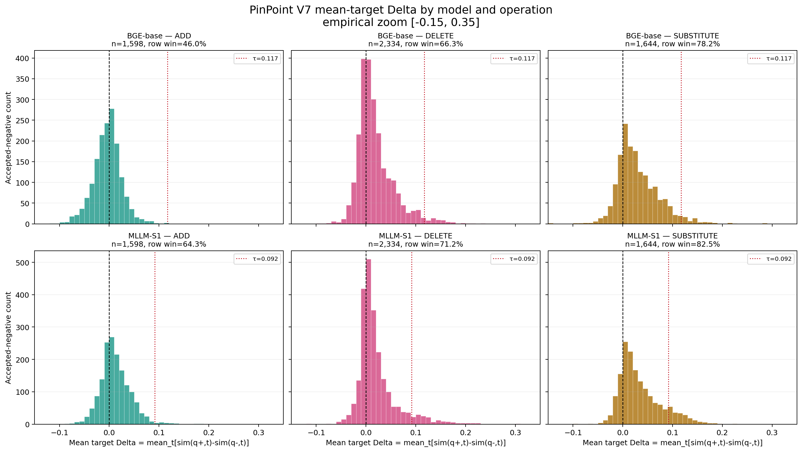
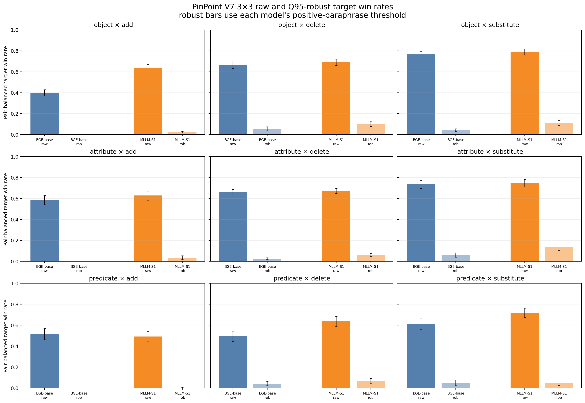
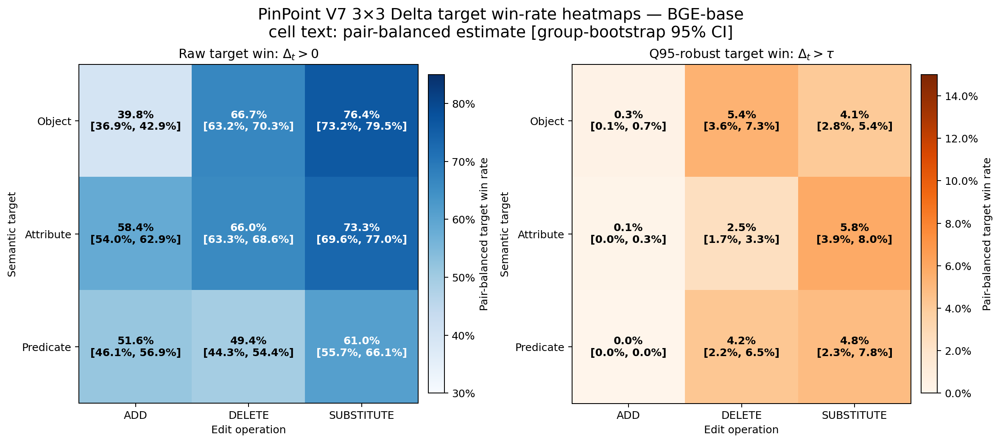
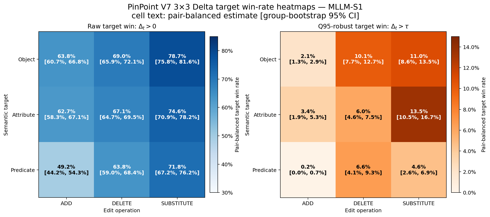
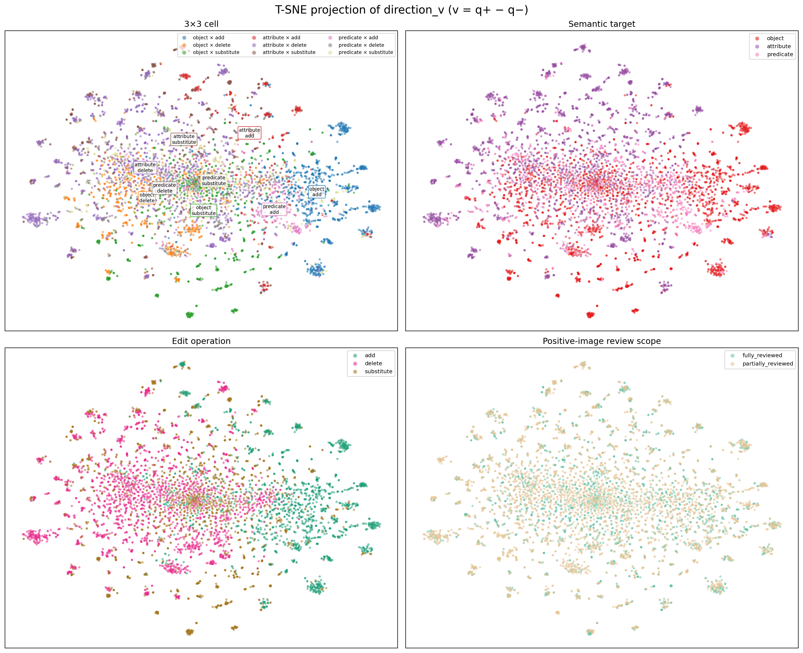
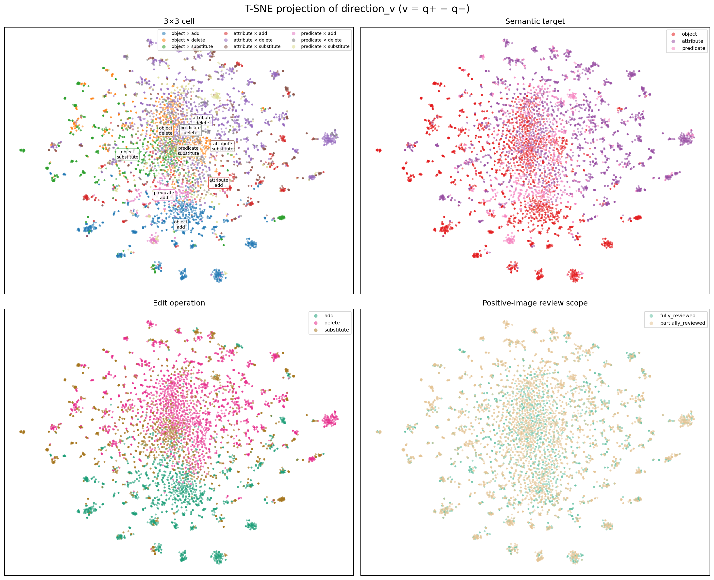

# PinPoint V7 组合图像检索诊断基准：数据构造、评估结果与结论

> 版本日期：2026-07-28  
> 数据目录：`pinpoint_pilot_500_v7`  
> 评估模型：`BGE-VL-base`、`BGE-VL-MLLM-S1`

## 0. 范围声明

本文只分析以下 PinPoint V7 数据和结果：

```text
/mnt/data/datasets/search_dataset/zxl/benchmark_build/
  cir_qdiag_openai/outputs/pinpoint_pilot_500_v7/
```

本文不使用旧的 `cir_qdiag/outputs/pilot_500_v5`，也不把旧数据的线性 probe 或 t-SNE
数值混入 V7 结论。

主要文件：

- [V7 数据说明](README.md)
- [最终 V7 数据](final.jsonl)
- [逐组可视化审核页](audit.html)
- [3×3 生成数量](generation_by_edit.csv)
- [3×3 审核结果](selection_by_edit.csv)
- [两模型负样本汇总](full_retrieval_diagnostics/combined_negative_summary.csv)
- [两模型正样本汇总](full_retrieval_diagnostics/combined_positive_summary.json)
- [Delta mode analysis](full_retrieval_diagnostics/delta_mode_analysis/summary.md)

## 1. 摘要

本 benchmark 从原始 PinPoint 的组合图像检索查询中寻找具有完全相同 Reference、
Positive 集合和官方 Negative 集合的 instruction 改写组，再对每条原 instruction
生成局部的 3×3 文本编辑：

```text
semantic target ∈ {object, attribute, predicate}
edit operation  ∈ {ADD, DELETE, SUBSTITUTE}
```

Text-only 生成模型只负责提出局部编辑；随后 vision-grounded 审核模型查看 Reference
和最多 4 张 Positive 图像，筛除与 Positive 兼容、视觉不可判断、语义类别错误或不是
单次局部编辑的候选。

最终得到：

- 500 个 PinPoint 改写组；
- 1,933 条原始正向 instruction；
- 11,743 条生成候选；
- 5,576 条审核通过的局部编辑文本；
- 其中 3,242 条严格负样本（ADD + SUBSTITUTE）；
- 2,334 条 DELETE 弱查询诊断样本。

核心发现如下。

1. **PinPoint 正改写本身会造成显著检索波动。**  
   具有相同检索标注的正改写，Top-10 平均只共享约 4.0 张图（Base）或 5.5 张图
   （MLLM-S1）。因此不能简单用 `Delta > 0` 定义成功，必须用正改写噪声校准。

2. **严格负样本能显著降低原正图的全库排名。**  
   NDCG@10 从 0.1547 降至 0.0807（Base），从 0.2080 降至 0.1155
   （MLLM-S1），相对下降约 48% 和 44%。

3. **但多数目标余弦下降没有超过自然改写的 Q95 扰动。**  
   严格集合的原始目标胜率为 60.8% / 70.0%，经过正常改写门槛后只剩
   3.37% / 8.26%。模型能感知编辑并重排，但这种控制信号通常弱于自然表达变化。

4. **SUBSTITUTE 明显强于 ADD。**  
   互斥属性或对象替换（如 black→white、bedroom→kitchen）最容易产生正确响应；
   添加一个正图中缺失的条件时，模型经常把新增视觉词当成额外匹配证据，而没有执行
   “所有条件必须同时满足”的合取逻辑。

5. **Predicate 是最明显的薄弱项。**  
   Predicate ADD 的稳健目标胜率接近 0，NDCG 下降最小，Top-K Jaccard 最高，
   表明模型对动作、状态和对象关系约束不敏感。

6. **编辑向量具有局部可解码结构，但没有形成九个固定全局簇。**  
   同一 3×3 单元格在近邻中明显富集，但 silhouette 为负，KMeans-9 ARI
   只有 0.11～0.14。ADD/DELETE/SUBSTITUTE 的几何结构比
   object/attribute/predicate 更稳定；主要信息存在于向量方向而不是长度。

## 2. 原始数据来源：PinPoint

原始数据位于：

```text
/mnt/data/datasets/search_dataset/zxl/pinpoint-dataset/
```

主要源文件为
[pinpoint_licensed.parquet](../../../../pinpoint-dataset/pinpoint_licensed.parquet)，
包含 7,635 条查询，每条记录包括：

- 1～2 张 Reference 图像；
- 一条 modification instruction；
- Positive candidate 图像集合；
- 官方 Negative candidate 图像集合；
- query category、文本长度、问句/祈使句等元数据。

PinPoint 全库索引含 109,600 个唯一图像 ID。当前本地图像缓存实际成功加载
109,598 张，缺少 2 张；本次 500 组的 Positive 图像均未缺失。

需要强调：本目录不是复制一份原始 PinPoint，而是以 PinPoint 标注为基础构造的
**局部语义 hard-negative text 派生基准**。

## 3. 如何从 PinPoint 构造 V7 数据

### 3.1 精确构造正改写组

只有同时满足以下条件的 PinPoint query 才被分到同一组：

1. Reference 图像集合完全相同；
2. Positive image ID 集合完全相同；
3. 官方 Negative image ID 集合完全相同。

随后只保留包含 2～6 条 instruction 的组。因此，组内文本并不是依靠文本相似度
“猜测”为同义改写，而是具有完全相同的检索标注。

本次使用随机种子 42 抽取 500 组，共覆盖 1,933 条原 instruction。

没有额外对 PinPoint 原始样本做人工质量筛除。因此“相同检索标签”是正改写关系的
操作性定义，不等于每对文本都经过人工逐句同义审核。

### 3.2 Text-only 生成 3×3 候选

对每条原 instruction，生成模型在不查看图像的情况下尝试三种操作：

- `ADD`：插入一个连续的新语义约束；
- `DELETE`：删除一个连续的语义约束；
- `SUBSTITUTE`：把一个连续语义跨度替换为另一个跨度。

每种操作分别作用于：

- `object`：对象身份、类别或对象是否存在；
- `attribute`：颜色、材质、尺寸、风格等属性；
- `predicate`：动作、状态或对象间关系。

候选必须：

- 只进行一次局部编辑；
- 除必要空格和标点外不改写其他部分；
- 保持文本自然、流畅；
- 正确标注 semantic target 和 edit operation。

模型可以返回 `null`，所以不是每条 instruction 都恰好产生 9 条候选。

### 3.3 Vision-grounded 审核

审核模型按组查看：

- 全部 Reference 图像；
- 从完整 Positive 集合中确定性选择的最多 4 张 Positive 图像；
- 本组所有原 instruction；
- 本组所有候选文本。

审核模型不查看 PinPoint 官方 Negative 图像。

审核规则：

- `ADD` / `SUBSTITUTE`：新增或替换后的事实必须对所有送审 Positive 明确为假；
  只要一张仍兼容就拒绝；
- `DELETE`：不要求与 Positive 矛盾，只要求是自然、合法、单约束的严格弱化；
- 所有操作都必须视觉可判断、语义类别正确、接近原文本且只做一次编辑。

因此：

```text
strict = ADD + SUBSTITUTE
```

是主要 hard-negative 集合；DELETE 是“更弱查询”诊断，不能和 strict 混在一起解释为
负样本正确率。

### 3.4 生成与接受数量

| Semantic target | Operation | 生成候选 | 审核通过 | 通过率 |
|---|---:|---:|---:|---:|
| Object | ADD | 1,674 | 947 | 56.6% |
| Object | DELETE | 918 | 643 | 70.0% |
| Object | SUBSTITUTE | 1,543 | 767 | 49.7% |
| Attribute | ADD | 1,845 | 411 | 22.3% |
| Attribute | DELETE | 1,612 | 1,383 | 85.8% |
| Attribute | SUBSTITUTE | 1,342 | 567 | 42.3% |
| Predicate | ADD | 1,094 | 240 | 21.9% |
| Predicate | DELETE | 397 | 308 | 77.6% |
| Predicate | SUBSTITUTE | 1,318 | 310 | 23.5% |
| **合计** |  | **11,743** | **5,576** | **47.5%** |

主要拒绝原因：

| 拒绝原因 | 数量 | 含义 |
|---|---:|---|
| `positive_compatible` | 3,693 | 至少一张送审 Positive 仍兼容候选 |
| `not_visually_verifiable` | 1,029 | 无法从图像可靠判断 |
| `wrong_semantic_target` | 409 | 编辑内容与声明类别不一致 |
| `invalid_delete` | 307 | 不是合法单约束弱化 |
| `other_semantic_failure` | 243 | 其他语义问题 |
| `not_single_edit` | 215 | 改变零个或多个语义约束 |
| `not_fluent` | 210 | 文本不自然或不完整 |
| `not_close_or_hard` | 61 | 离原查询太远或不构成 hard negative |

最终平均每条 instruction 有 2.89 条通过审核的编辑文本，每组平均 11.15 条。
499/500 个组至少有一条通过样本；1 个组的候选全部被拒绝。71 条 instruction
没有任何通过的负样本。

## 4. 模型评估设计

### 4.1 模型与查询

本文只评估：

- `BGE-VL-base`
- `BGE-VL-MLLM-S1`

对每条原文本及其局部编辑定义：

```text
q+ = f(R, m+)
q- = f(R, m-)
t  = f(T)
v  = q+ - q-
```

其中 `R` 是 1～2 张 Reference 图像，`T` 是原 PinPoint Positive target。

目标差值：

```math
\Delta_t
= \operatorname{sim}(q^+,t)-\operatorname{sim}(q^-,t)
= v^\top t
```

每个模型共编码：

- 1,933 条正查询；
- 5,576 条负/弱化查询；
- 合计 7,509 条 query embedding。

全库精确检索对 109,598 张实际可用图像计算 Top-50，再报告
`K ∈ {1,5,10,50}`。

### 4.2 统计加权

主结果不是直接对 5,576 行取普通平均，而是：

1. 在同一 instruction 内平均其 negatives；
2. 在同一 PinPoint 改写组内平均 instructions；
3. 最后让每个组等权。

置信区间按组 bootstrap。这样可以避免某个组因为 instruction 或 accepted negative
更多而支配结果。

但 3×3 单元格之间并未自动等权，因此本文同时报告实际分布加权结果和六个 strict
单元格等权宏平均。

### 4.3 指标定义

#### 原始目标胜率

```math
\mathbb{1}[\Delta_t>0]
```

表示原文本对原正图的相似度高于编辑文本。

#### 正改写扰动门槛与稳健胜率

同一 PinPoint 组内的正改写具有相同检索标注。用它们估计正常表达变化：

```math
\epsilon =
\left|
\operatorname{sim}(f(R,m_i^+),t)
-\operatorname{sim}(f(R,m_j^+),t)
\right|
```

对每组等权后取绝对扰动的 Q95 作为模型门槛 `τ`。稳健胜率定义为：

```math
\mathbb{1}[\Delta_t>\tau]
```

它表示局部负编辑造成的目标下降不仅为正，而且大于 95% 正改写噪声。

#### Positive NDCG

使用原 PinPoint Positive 图像作为二元 relevance，在完整图库中计算标准 NDCG。

#### Negative residual NDCG

负文本目前没有“满足负文本的新相关图像”标注。因此负文本的 NDCG 不是标准负查询
检索质量，而是：

> 继续把原 Positive 图像当作 relevant，测量编辑后这些原正图还残留多少排名。

该值越低，说明负编辑越能压制原正图。

#### Top-K Jaccard

```math
J(A,B)=\frac{|A\cap B|}{|A\cup B|}
```

本文比较：

1. 同组两个正改写的 Top-K 集合；
2. 原文本和其局部编辑文本的 Top-K 集合。

Jaccard 只表示检索邻域变化大小，不直接表示变化是否正确。

## 5. 正查询基线：PinPoint 本身有多难

### 5.1 全库 NDCG

| 模型 | NDCG@1 | NDCG@5 | NDCG@10 | NDCG@50 |
|---|---:|---:|---:|---:|
| BGE-VL-base | 0.1482 | 0.1455 | 0.1504 | 0.2024 |
| BGE-VL-MLLM-S1 | 0.2190 | 0.2005 | 0.2021 | 0.2556 |

同一组不同正改写的 NDCG@10 平均最大—最小跨度为：

- Base：0.1595；
- MLLM-S1：0.1401。

该跨度与正查询平均 NDCG 本身相当，说明改写措辞足以显著改变全库排名。

### 5.2 正改写 Top-K 稳定性

| 模型 | Jaccard@1 | Jaccard@5 | Jaccard@10 | Jaccard@50 |
|---|---:|---:|---:|---:|
| BGE-VL-base | 0.2498 | 0.2380 | 0.2514 | 0.2933 |
| BGE-VL-MLLM-S1 | 0.3858 | 0.3641 | 0.3779 | 0.4131 |

两个大小均为 10 的集合，Jaccard 为 `J` 时，交集大小为：

```math
|A\cap B|=\frac{20J}{1+J}
```

因此同组正改写的 Top-10 平均只共享：

- Base：约 4.0 张图；
- MLLM-S1：约 5.5 张图。

这说明本 benchmark 同时测量两种能力：

1. 对意义保持改写保持稳定；
2. 对局部语义改变保持敏感。

一个理想模型应当“正改写稳定、负编辑敏感”，而不是对所有文本变化都敏感。

## 6. Delta、初始相似度与目标胜率

### 6.1 正改写校准门槛

| 模型 | Q95 门槛 `τ` | Bootstrap 95% CI | 校准组数 | 目标级扰动观测 |
|---|---:|---:|---:|---:|
| BGE-VL-base | 0.1173 | [0.1121, 0.1233] | 500 | 28,781 |
| BGE-VL-MLLM-S1 | 0.0918 | [0.0867, 0.0998] | 500 | 28,781 |

门槛是模型自身的自然改写尺度，因此适合判断单模型内部的“异常大语义效应”；
不同模型的稳健胜率使用了不同绝对门槛，跨模型比较时必须同时报告 `τ`。

### 6.2 strict 集合的初始值、Delta 与胜率

| 模型 | 平均 sim(q+,t) | 平均 sim(q-,t) | 平均 Delta | 原始胜率 | 稳健胜率 |
|---|---:|---:|---:|---:|---:|
| BGE-VL-base | 0.2101 | 0.1952 | 0.0149 | 60.8% [58.7%, 62.8%] | 3.37% [2.51%, 4.28%] |
| BGE-VL-MLLM-S1 | 0.2470 | 0.2237 | 0.0233 | 70.0% [68.2%, 72.0%] | 8.26% [6.88%, 9.61%] |

因此不能只说“余弦很低”或只看差值：

- 两模型的原正图平均相似度约为 0.21 和 0.25；
- strict 编辑后的相似度约为 0.20 和 0.22；
- 大部分编辑的下降方向正确；
- 但平均下降远小于正改写 Q95 门槛。

这表示模型通常能感知编辑，但这种信号相对于语言表达噪声不够强。

### 6.3 按 operation 汇总

| 模型 | Operation | sim(q+,t) | sim(q-,t) | Delta | 原始胜率 | 稳健胜率 |
|---|---|---:|---:|---:|---:|---:|
| Base | ADD | 0.2091 | 0.2120 | -0.0030 | 46.0% | 0.28% |
| Base | DELETE | 0.2100 | 0.1896 | 0.0203 | 65.3% | 4.10% |
| Base | SUBSTITUTE | 0.2119 | 0.1817 | 0.0302 | 73.0% | 5.43% |
| MLLM-S1 | ADD | 0.2456 | 0.2350 | 0.0106 | 61.7% | 1.95% |
| MLLM-S1 | DELETE | 0.2447 | 0.2224 | 0.0224 | 68.6% | 8.57% |
| MLLM-S1 | SUBSTITUTE | 0.2497 | 0.2154 | 0.0343 | 77.7% | 13.28% |

Base 的 ADD 平均 `sim(q-,t)` 反而高于 `sim(q+,t)`。这揭示了 ADD 的核心难点：
新增“scarf、ottoman、platter”等视觉词后，即使原图不满足新增条件，文本可能变得更像
普通图像描述，从而增加图文相似度。模型识别了新增概念，却没有可靠执行
“A 且 B 必须同时成立”。

DELETE 的 Delta 不能当作负样本成功率。删除约束后查询更弱，目标得分下降或上升都只反映
该条件对模型表示的贡献。

### 6.4 Delta 分布与 `delta_mode_analysis`

这里沿用历史输出目录名 `delta_mode_analysis`，但 PinPoint V7 **不存在**
`text_only_editable` 与 `vision_grounded` 两套平行 construction mode。V7 的统一流程是：
先 text-only 生成候选，再由 vision-grounded 模型审核。因此本节按真实存在的维度分析：

- 模型；
- ADD / DELETE / SUBSTITUTE；
- object / attribute / predicate × operation 的 3×3 单元格；
- Positive 图像完整审核或最多审核 4 张。

直方图中的每个观测是一条审核通过的负文本，其横坐标为该条文本在同组所有原 Positive
目标上的平均值：

\[
\overline{\Delta}
=
\operatorname{mean}_{t\in T}
\left[
\operatorname{sim}(f(R,m^+),t)
-
\operatorname{sim}(f(R,m^-),t)
\right].
\]

单个余弦相似度位于 `[-1,1]`，所以 Delta 的理论范围确实是 `[-2,2]`。V7 实际观测远比
理论范围集中：全部负文本的 1%～99% 分位区间，Base 为 `[-0.0637, 0.1439]`，
MLLM-S1 为 `[-0.0439, 0.1530]`；所有行的经验显示范围约为 `[-0.15,0.35]`。

| 模型 | 子集 | 平均 Delta（组层级 95% CI） | 行级 P01 | 行级中位数 | 行级 P99 |
|---|---|---:|---:|---:|---:|
| Base | all | 0.0172 [0.0153, 0.0193] | -0.0637 | 0.0085 | 0.1439 |
| Base | strict | 0.0149 [0.0124, 0.0175] | -0.0720 | 0.0076 | 0.1428 |
| Base | ADD | -0.0030 [-0.0050, -0.0010] | -0.0776 | -0.0025 | 0.0760 |
| Base | DELETE | 0.0203 [0.0178, 0.0228] | -0.0411 | 0.0095 | 0.1501 |
| Base | SUBSTITUTE | 0.0302 [0.0270, 0.0336] | -0.0511 | 0.0216 | 0.1610 |
| MLLM-S1 | all | 0.0230 [0.0208, 0.0252] | -0.0439 | 0.0124 | 0.1530 |
| MLLM-S1 | strict | 0.0233 [0.0209, 0.0258] | -0.0441 | 0.0153 | 0.1435 |
| MLLM-S1 | ADD | 0.0106 [0.0084, 0.0128] | -0.0514 | 0.0080 | 0.1015 |
| MLLM-S1 | DELETE | 0.0224 [0.0198, 0.0250] | -0.0430 | 0.0095 | 0.1672 |
| MLLM-S1 | SUBSTITUTE | 0.0343 [0.0309, 0.0376] | -0.0303 | 0.0234 | 0.1537 |

完整理论范围图能够验证边界，但真实分布会被压缩在零附近：

- [理论范围 `[-2,2]` 直方图](full_retrieval_diagnostics/delta_mode_analysis/delta_hist_by_model_operation_full_range.png)

放大到经验区间后，可以清楚看到 Base ADD 的分布中心略偏向零左侧，而 SUBSTITUTE
整体最明显地右移：



3×3 胜率图中的深色柱为 `Delta > 0`，浅色柱为 `Delta > τ`。绝大多数单元格从原始胜率
到稳健胜率均大幅下降；这不是图画错，而是两个模型的 Q95 门槛
`τ=0.1173/0.0918` 均位于 Delta 分布的右尾。



为方便直接阅读单元格，又为每个模型分别生成一张热力图。左图是原始胜率，右图是
Q95 稳健胜率；每个格子显示组平衡估计值及组层级 bootstrap 95% CI。两个模型在同一种
指标上共用色标范围，可以跨模型比较；raw 和 robust 使用不同色标范围，不能用蓝色与
橙色的颜色深浅直接比较绝对数值。





需要注意三种统计口径：

- 直方图计数和图标题中的 `row win` 按“审核通过的负文本行”计算；
- 表中的平均值和置信区间先在 instruction pair / group 内平衡，再做组层级 bootstrap；
- 稳健胜率是在每个 Positive target 上判断 `Delta_t > τ`，不是先对 target 求平均后再过门槛。

因此直方图中红线右侧的行占比、图标题的行级胜率和主表的 target 级组平衡胜率不要求
数值完全相同。完整产物见
[Delta 分析说明](full_retrieval_diagnostics/delta_mode_analysis/summary.md)、
[汇总数据](full_retrieval_diagnostics/delta_mode_analysis/delta_summary.csv)和
[直方图分箱](full_retrieval_diagnostics/delta_mode_analysis/delta_histogram_bins.csv)。

## 7. 全库 NDCG 结果

### 7.1 strict 集合在不同 K 下的原正图残留

| 模型 | K | Positive NDCG | Negative residual NDCG | Delta NDCG |
|---|---:|---:|---:|---:|
| Base | 1 | 0.1536 | 0.0777 | 0.0759 |
| Base | 5 | 0.1500 | 0.0771 | 0.0729 |
| Base | 10 | 0.1547 | 0.0807 | 0.0739 |
| Base | 50 | 0.2083 | 0.1234 | 0.0849 |
| MLLM-S1 | 1 | 0.2284 | 0.1177 | 0.1107 |
| MLLM-S1 | 5 | 0.2069 | 0.1108 | 0.0961 |
| MLLM-S1 | 10 | 0.2080 | 0.1155 | 0.0924 |
| MLLM-S1 | 50 | 0.2642 | 0.1602 | 0.1040 |

NDCG@10 主结果：

| 模型 | Positive | Negative residual | 下降量及 95% CI | 相对下降 | 普通 NDCG 胜率 |
|---|---:|---:|---:|---:|---:|
| Base | 0.1547 | 0.0807 | 0.0739 [0.0637, 0.0851] | 47.8% | 34.8% |
| MLLM-S1 | 0.2080 | 0.1155 | 0.0924 [0.0793, 0.1044] | 44.4% | 41.0% |

### 7.2 为什么普通 NDCG 胜率看起来不高

很多原正查询本身在 Top-10 中一个 Positive 都没有，此时 NDCG 已经是 0，负编辑没有
继续下降的空间。

| 模型 | strict 原查询 NDCG@10 非零 | 在非零条件下负编辑使 NDCG 下降 |
|---|---:|---:|
| Base | 42.7% | 81.6% |
| MLLM-S1 | 52.1% | 80.1% |

条件胜率是补充性、事后统计，未附 bootstrap CI；它用于解释 floor effect，不应替代
主 NDCG 差值。

可以得出的稳健结论是：

> 只要模型原本能把正图放入 Top-10，大约 80% 的 strict 编辑会进一步降低原正图 NDCG。

### 7.3 按 operation 的 NDCG@10

| 模型 | Operation | Positive | Negative residual | Delta NDCG | NDCG 胜率 |
|---|---|---:|---:|---:|---:|
| Base | ADD | 0.1513 | 0.1002 | 0.0511 | 31.2% |
| Base | DELETE | 0.1543 | 0.1157 | 0.0386 | 27.0% |
| Base | SUBSTITUTE | 0.1590 | 0.0715 | 0.0875 | 36.7% |
| MLLM-S1 | ADD | 0.2076 | 0.1309 | 0.0767 | 38.3% |
| MLLM-S1 | DELETE | 0.2046 | 0.1607 | 0.0439 | 31.4% |
| MLLM-S1 | SUBSTITUTE | 0.2172 | 0.1148 | 0.1024 | 43.6% |

SUBSTITUTE 对全库排名的影响最强，DELETE 最弱，符合其语义性质。ADD 的目标余弦效应弱，
但仍会降低 NDCG，说明它可能通过提升其他候选或改变全局邻域来影响排名；因此必须同时看
目标 Delta 和全库 NDCG，不能把其中任一个单独当作完整解释。

## 8. Top-K 检索集合 Jaccard

### 8.1 正改写基线与 strict 编辑

| 模型 | 比较对象 | J@1 | J@5 | J@10 | J@50 |
|---|---|---:|---:|---:|---:|
| Base | 正改写 vs 正改写 | 0.2498 | 0.2380 | 0.2514 | 0.2933 |
| Base | 原文本 vs strict 编辑 | 0.2727 | 0.2644 | 0.2764 | 0.3359 |
| MLLM-S1 | 正改写 vs 正改写 | 0.3858 | 0.3641 | 0.3779 | 0.4131 |
| MLLM-S1 | 原文本 vs strict 编辑 | 0.2857 | 0.2849 | 0.2944 | 0.3403 |

strict Jaccard@10 的 bootstrap CI：

- Base：0.2764，[0.2613, 0.2923]；
- MLLM-S1：0.2944，[0.2768, 0.3112]。

换算为 Top-10 交集：

- Base strict 原/负文本平均共享约 4.3 张图；
- MLLM-S1 平均共享约 4.5 张图。

解释：

- MLLM-S1 中，strict 编辑造成的集合变化大于正改写自身变化；
- Base 中，strict 编辑的集合变化没有超过正改写基线；
- 两模型的正负查询仍共享约一半 Top-10，说明这些编辑保持了 hard-negative 的“近”，
  而不是完全换了检索主题。

### 8.2 按 operation 的 Jaccard@10

| 模型 | ADD | DELETE | SUBSTITUTE |
|---|---:|---:|---:|
| Base | 0.3029 | 0.4089 | 0.2689 |
| MLLM-S1 | 0.2961 | 0.4663 | 0.3029 |

DELETE 的重合度最高，符合“弱化查询仍应保留较多原结果”。SUBSTITUTE 的重合度最低，
说明互斥替换最能改变检索邻域。

## 9. 完整 3×3 结果

下表中：

- `raw/robust`：原始目标胜率 / 超过正改写 Q95 门槛的稳健胜率；
- `dN10`：Positive NDCG@10 − Negative residual NDCG@10；
- `J10`：原文本与编辑文本的 Top-10 Jaccard。

| Cell | 数量 | Base raw/robust | Base dN10 | Base J10 | S1 raw/robust | S1 dN10 | S1 J10 |
|---|---:|---:|---:|---:|---:|---:|---:|
| Object ADD | 947 | 39.8% / 0.34% | 0.0501 | 0.2823 | 63.8% / 2.08% | 0.0807 | 0.2508 |
| Object DELETE | 643 | 66.7% / 5.38% | 0.0374 | 0.4143 | 69.0% / 10.05% | 0.0387 | 0.5411 |
| Object SUBSTITUTE | 767 | 76.4% / 4.05% | 0.0867 | 0.2483 | 78.8% / 10.97% | 0.0877 | 0.3307 |
| Attribute ADD | 411 | 58.4% / 0.12% | 0.0520 | 0.3280 | 62.7% / 3.45% | 0.0881 | 0.3415 |
| Attribute DELETE | 1,383 | 66.0% / 2.47% | 0.0355 | 0.4279 | 67.1% / 6.03% | 0.0387 | 0.4682 |
| Attribute SUBSTITUTE | 567 | 73.3% / 5.83% | 0.1015 | 0.2579 | 74.6% / 13.52% | 0.1253 | 0.2674 |
| Predicate ADD | 240 | 51.6% / 0.00% | 0.0260 | 0.4313 | 49.2% / 0.24% | 0.0310 | 0.4488 |
| Predicate DELETE | 308 | 49.4% / 4.23% | 0.0190 | 0.4523 | 63.8% / 6.57% | 0.0381 | 0.5211 |
| Predicate SUBSTITUTE | 310 | 61.0% / 4.85% | 0.0493 | 0.4425 | 71.8% / 4.58% | 0.0437 | 0.4438 |

### 9.1 Attribute SUBSTITUTE 最稳定有效

它在两模型中都具有：

- 最大或接近最大的 NDCG 下降；
- 较低的 Top-K Jaccard；
- 较高的稳健目标胜率。

black→white、large→small 等互斥属性提供了明确、视觉可判断的冲突。

### 9.2 Object SUBSTITUTE 也有清晰效果

bedroom→kitchen 等对象类别替换能明显降低原正图排名。它比 ADD 更容易，因为新旧对象
通常具有显式语义对立。

### 9.3 ADD 暴露合取约束问题

ADD 的逻辑形式是：

```text
原查询：A
编辑后：A AND B
原正图：满足 A，但不满足 B
```

模型需要判断“缺少 B 就不满足整个查询”。结果表明，尤其在 Base 中，新增视觉词有时会
增加相似度。该 benchmark 因而能诊断模型是否只是累加相关概念，而没有执行条件合取。

### 9.4 Predicate 是最难的语义

Predicate ADD 同时表现为：

- 稳健胜率近 0；
- NDCG 下降最小；
- Jaccard 最高。

这三类证据方向一致，支持模型对动作、关系和状态条件的敏感度弱，而不仅是某一个指标的
偶然波动。

### 9.5 DELETE 必须单列

DELETE 删除一个条件，查询严格变弱。原 Positive 通常仍应兼容弱化后的查询，所以：

- 高 Jaccard 是预期现象；
- residual NDCG 较高也是预期现象；
- `Delta <= 0` 不能直接叫模型错误。

DELETE 更适合诊断“被删条件对模型表示贡献多大”，不适合与 strict hard negative
共同计算负样本成功率。

## 10. 编辑向量 `v=q+−q-` 的降维与聚类

### 10.1 分析目的

`q+` 和 `q-` 使用相同 Reference，且文本只做局部编辑，因此：

```math
v=q^+-q^-
```

在一定程度上消除了两查询共享的图像和文本内容，用于检查模型对编辑本身的响应。

本文分别分析：

- `raw_v`：同时包含方向与长度；
- `direction_v = v/||v||`：只看编辑方向。

每个模型使用正确的 PinPoint V7 query cache，包含全部 5,576 个 accepted edits。
先降至 PCA-50 作为分析空间，再生成 PCA-2D 和 t-SNE-2D。量化指标包括：

- 3×3 标签 silhouette；
- 15-NN 标签纯度及按类别频率调整后的纯度；
- KMeans 的 ARI/NMI；
- 二维投影 trustworthiness。

t-SNE 只用于观察局部结构；二维“岛屿”的绝对距离、面积和形状不应被解释。

### 10.2 3×3 聚类指标

| 模型 | 向量 | PCA-50 方差 | Cell silhouette | KMeans-9 ARI | KMeans-9 NMI | 调整后近邻纯度 | t-SNE trustworthiness |
|---|---|---:|---:|---:|---:|---:|---:|
| Base | raw v | 0.5617 | -0.0895 | 0.0595 | 0.1964 | 0.4068 | 0.8721 |
| Base | direction v | 0.4969 | -0.0080 | 0.1107 | 0.2073 | 0.4658 | 0.9425 |
| MLLM-S1 | raw v | 0.4685 | -0.1401 | 0.0908 | 0.2422 | 0.4156 | 0.8818 |
| MLLM-S1 | direction v | 0.3939 | -0.0469 | 0.1419 | 0.2530 | 0.4550 | 0.9495 |

正确解释是：

> 3×3 标签在局部邻域中有真实结构，但没有形成九个紧凑、单峰、相互分离的全局簇。

silhouette 为负且 KMeans-9 ARI 较低，所以不能说模型内部存在九个固定编辑向量。
但调整后近邻纯度约 0.46，说明同类点在局部显著富集，也不能说编辑标签在表示中完全
不存在。

### 10.3 Operation 与 semantic target

direction-v 的 KMeans 结果：

| 模型 | Operation ARI/NMI | Semantic target ARI/NMI |
|---|---:|---:|
| Base | 0.2035 / 0.2208 | 0.0540 / 0.0523 |
| MLLM-S1 | 0.2549 / 0.2917 | 0.0769 / 0.0794 |

ADD/DELETE/SUBSTITUTE 的几何结构比 object/attribute/predicate 更统一。原因是：

- ADD 总体增加语义；
- DELETE 总体减少语义；
- SUBSTITUTE 同时移除旧概念并加入新概念。

而 attribute 可以是颜色、尺寸、材质、风格等完全不同的内容；object 和 predicate
同样具有多个语义子类型，因此不会共享一个单一绝对方向。

### 10.4 方向比长度更重要

两个模型中，direction-v 的近邻纯度、KMeans ARI 和 t-SNE trustworthiness 都优于
raw-v。这说明 3×3 信息主要位于“向哪个方向移动”，而不是“移动多远”。

### 10.5 审核范围不是主要聚类混杂

对 `fully_reviewed/partially_reviewed` 进行 KMeans 对照：

| 模型 | direction-v ARI | direction-v NMI |
|---|---:|---:|
| Base | 0.0050 | 0.0013 |
| MLLM-S1 | 0.0068 | 0.0015 |

接近 0 的结果说明图中的主要局部结构不是简单由“完整审核还是最多审核 4 张”造成。

### 10.6 可视化

#### BGE-VL-base direction-v



#### BGE-VL-MLLM-S1 direction-v



完整坐标与指标：

- [Base vector report](full_retrieval_diagnostics/BGE-VL-base/analysis/vector_visualization/report.json)
- [Base coordinates](full_retrieval_diagnostics/BGE-VL-base/analysis/vector_visualization/coordinates.csv)
- [MLLM-S1 vector report](full_retrieval_diagnostics/BGE-VL-MLLM-S1/analysis/vector_visualization/report.json)
- [MLLM-S1 coordinates](full_retrieval_diagnostics/BGE-VL-MLLM-S1/analysis/vector_visualization/coordinates.csv)

### 10.7 `v` 聚类不等于方向正确

向量结构与检索正确性是两个问题：

| `v` 结构 | Delta/NDCG | 含义 |
|---|---|---|
| 清楚 | 正确 | 学到稳定且有效的编辑响应 |
| 清楚 | 不正确 | 识别了编辑类型，但移动方向与目标无关或错误 |
| 不聚类 | 正确 | 响应依赖具体内容，但检索行为正确 |
| 不聚类 | 不正确 | 既无稳定结构，也无正确检索效果 |

因此 t-SNE 必须与 `Delta=v·t`、NDCG 和 Jaccard 联合解释。

## 11. 这个 benchmark 能诊断模型什么问题

| 观测模式 | 可诊断的行为问题 |
|---|---|
| Positive NDCG 很低 | 基础组合检索能力不足 |
| 正改写 Jaccard 低、NDCG 波动大、`τ` 高 | 对同义或意义保持表达不稳定 |
| ADD Delta 接近 0 或为负 | 没有可靠执行新增条件的合取逻辑 |
| Object SUBSTITUTE 不敏感 | 对象身份或类别替换不敏感 |
| Attribute SUBSTITUTE 不敏感 | 细粒度属性或属性绑定能力弱 |
| Predicate 编辑不敏感 | 动作、状态、空间关系或对象关系理解弱 |
| DELETE 几乎不影响表示 | 被删条件原本没有被模型利用，或语义冗余 |
| 目标 Delta 正确但 NDCG 不下降 | 感知到编辑，但分数 margin 不足以改变全库排名 |
| NDCG 下降但目标 Delta 很小 | 可能是整体 query drift 或其他候选上升，而不是准确排斥原正图 |
| 正负 Jaccard 很高 | 检索邻域对语义编辑反应不足 |
| 正负 Jaccard 很低但 Delta 方向混乱 | 编辑导致全局漂移，而非可控局部变化 |
| direction-v 可解码但不形成簇 | 存在分布式/多模态编辑信息，而非固定原型向量 |

该 benchmark 诊断的是可观察行为，不能仅凭这些指标确定问题来自文本编码器、视觉编码器、
融合模块还是训练数据。进一步定位模块需要 Reference-only、text-only、遮挡或结构化消融。

## 12. 数据与评估局限

### 12.1 负文本没有自己的相关图像

V7 只生成 hard-negative text，没有为每条编辑文本标注“真正满足编辑后查询的新正图”。
因此当前只能报告原正图 residual NDCG，不能报告负查询自身的标准检索 NDCG。

若希望完整评价负查询检索质量，需要为 `m-` 新增相关图像标注。

### 12.2 Vision 审核最多查看 4 张 Positive

500 个组中：

- 165 组的全部 Positive 都被审核；
- 335 组只有最多 4 张被审核；
- 1,891 条 accepted edit 来自完整审核组；
- 3,685 条来自部分审核组。

当前 Delta 和 NDCG 使用完整 Positive 集合，因此 strict 编辑对未送审 Positive
不具有同等强度的语义保证。

事后分层结果：

| 模型 | 审核覆盖 | strict 稳健胜率 | Delta NDCG@10 |
|---|---|---:|---:|
| Base | 全部 Positive 已审核 | 1.68% | 0.0561 |
| Base | 只审核最多 4 张 | 4.15% | 0.0822 |
| MLLM-S1 | 全部 Positive 已审核 | 4.76% | 0.0801 |
| MLLM-S1 | 只审核最多 4 张 | 9.88% | 0.0981 |

部分审核组的测得效应反而更强，因此没有证据表明“未审核 Positive”把总体胜率压低；
但这不能替代语义保证。未来应增加仅在 `validated_positive_image_ids` 上计算的 Delta，
或让审核覆盖全部 Positive。

### 12.3 3×3 数量不平衡

例如 Attribute DELETE 有 1,383 条，Predicate ADD 只有 240 条。当前 strict 总结果按
数据实际分布和组层级加权，并不是六个 strict 单元格等权。

六格等权宏平均：

| 模型 | 原始胜率 | 稳健胜率 | Delta NDCG@10 | Jaccard@10 |
|---|---:|---:|---:|---:|
| Base | 60.1% | 2.53% | 0.0609 | 0.3317 |
| MLLM-S1 | 66.8% | 5.81% | 0.0761 | 0.3472 |

正式报告应同时展示总体结果、单元格等权结果和完整 3×3 表。

### 12.4 PinPoint 标注中的少量冲突

本次组内 Positive 与官方 Negative 集合共有 25 个重叠 ID。主 Positive NDCG 仍按
Positive 标注计算；官方 Negative recall 诊断中排除了这些歧义 ID。官方 Negative
未参与 hard-negative text 生成或审核。

### 12.5 正改写门槛较保守

Q95 是全局、模型特定的高门槛。正改写差异可能同时包含：

- 正常语言表达变化；
- PinPoint 组内文本并非严格逐句同义；
- 模型本身的表达不稳定。

所以 3.37% / 8.26% 表示“超过全局正常变化高分位的强效果”，不等于只有这些样本
是有效负样本。

### 12.6 t-SNE 不能证明九类簇

t-SNE 强调局部邻域，会压缩或夸大二维簇间距离。本文使用 trustworthiness、
PCA 空间 silhouette、邻域纯度和 KMeans 指标限制解释范围。即使二维图出现岛屿，
只要原分析空间的聚类指标很低，就不能称为固定全局类别。

## 13. 最终结论

### 13.1 关于数据集

PinPoint V7 构造了一个有明确局部控制变量的组合检索诊断基准：

- Reference 和原正文本保持不变；
- 每条候选只编辑一个局部语义约束；
- 编辑类型具有 3×3 标注；
- strict 编辑经过视觉审核，尽量保证与送审 Positive 冲突；
- 同组原始 PinPoint 改写提供自然语言扰动基线；
- 完整图库检索同时提供目标分数、全局排名和邻域变化证据。

它测到的“难”不是单纯让所有模型 NDCG 低，而是：

> 正确改写之间应保持稳定，局部错误条件则应被模型可靠识别；当前模型对这两件事都不够稳定。

### 13.2 关于模型行为

两模型都不是完全看不懂局部编辑：

- strict 原始目标胜率超过 60%；
- strict NDCG@10 下降约 44%～48%；
- 在原查询有 Top-10 命中的条件下，约 80% 的 strict 编辑会进一步降低 NDCG。

但模型的语义控制仍然较弱：

- 大多数目标下降没有超过正改写 Q95 噪声；
- ADD 容易被当作相关概念累加，而不是必须满足的新条件；
- Predicate 的 Delta、NDCG 和 Jaccard 三项都显示响应最弱；
- 模型更容易识别显式互斥词，而不擅长合取和关系满足。

### 13.3 关于 3×3 向量结构

V7 结果不支持“模型内部存在九个固定编辑向量”的强结论。更准确的是：

> 模型表示中存在可检测的 3×3 局部方向结构，但每个类别是受具体对象、属性、关系、
> 文本和场景影响的多模态分布，而不是一个上下文无关的单一原型。

Operation 结构强于 semantic target，direction-v 强于 raw-v，说明模型更统一地编码
“增加/删除/替换”的操作形式，而 object/attribute/predicate 的实际方向高度依赖编辑内容。

### 13.4 推荐的正式报告口径

建议把以下指标作为主结果：

1. Positive NDCG 和正改写 Top-K Jaccard；
2. 模型特定正改写 Q95 门槛；
3. strict 原始胜率和稳健胜率；
4. strict Positive/Negative residual NDCG@10 及差值；
5. 原查询 NDCG 非零条件下的补充胜率；
6. strict 原/负 Top-10 Jaccard；
7. 完整 3×3 单元格结果；
8. 六个 strict 单元格等权宏平均；
9. direction-v 的邻域纯度、KMeans ARI/NMI 和 t-SNE trustworthiness。

DELETE 应始终单列，t-SNE 应始终与 Delta、NDCG、Jaccard 和原空间聚类指标联合解释。

## 14. 复现入口

全库诊断：

```bash
cd /mnt/data/datasets/search_dataset/zxl/benchmark_build/diag_model

python run_pinpoint_full_diagnostics.py \
  --input ../cir_qdiag_openai/outputs/pinpoint_pilot_500_v7/final.jsonl \
  --models BGE-VL-base,BGE-VL-MLLM-S1 \
  --device cuda:0
```

只使用已有 query cache 重跑 PCA/t-SNE，不重算模型和全库：

```bash
python run_pinpoint_full_diagnostics.py \
  --input ../cir_qdiag_openai/outputs/pinpoint_pilot_500_v7/final.jsonl \
  --models BGE-VL-base,BGE-VL-MLLM-S1 \
  --output-root ../cir_qdiag_openai/outputs/pinpoint_pilot_500_v7/full_retrieval_diagnostics \
  --visualization-only
```

使用已有全库诊断结果生成 `delta_mode_analysis`，不重新编码模型：

```bash
python analyze_pinpoint_delta_modes.py \
  --input ../cir_qdiag_openai/outputs/pinpoint_pilot_500_v7/final.jsonl \
  --diagnostics-root ../cir_qdiag_openai/outputs/pinpoint_pilot_500_v7/full_retrieval_diagnostics \
  --models BGE-VL-base,BGE-VL-MLLM-S1 \
  --bootstrap-replicates 5000
```

相关实现：

- [PinPoint full-corpus diagnostics](../../../diag_model/pinpoint_full_diagnostics.py)
- [PinPoint runner](../../../diag_model/run_pinpoint_full_diagnostics.py)
- [PinPoint V7 vector visualization](../../../diag_model/visualize_pinpoint_vectors.py)
- [PinPoint V7 Delta mode analysis](../../../diag_model/analyze_pinpoint_delta_modes.py)
